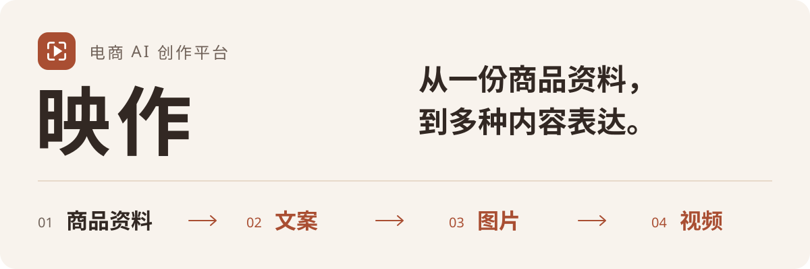
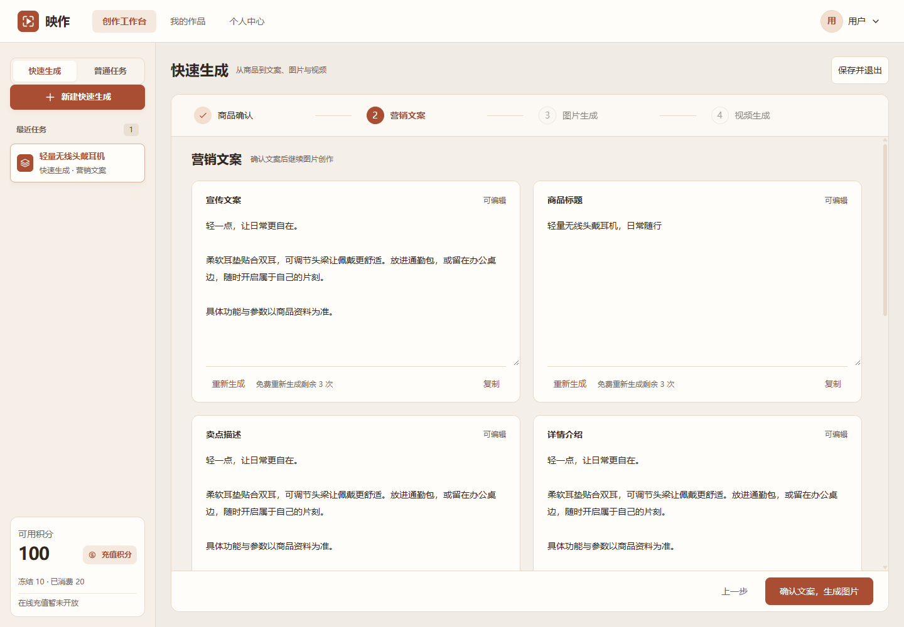
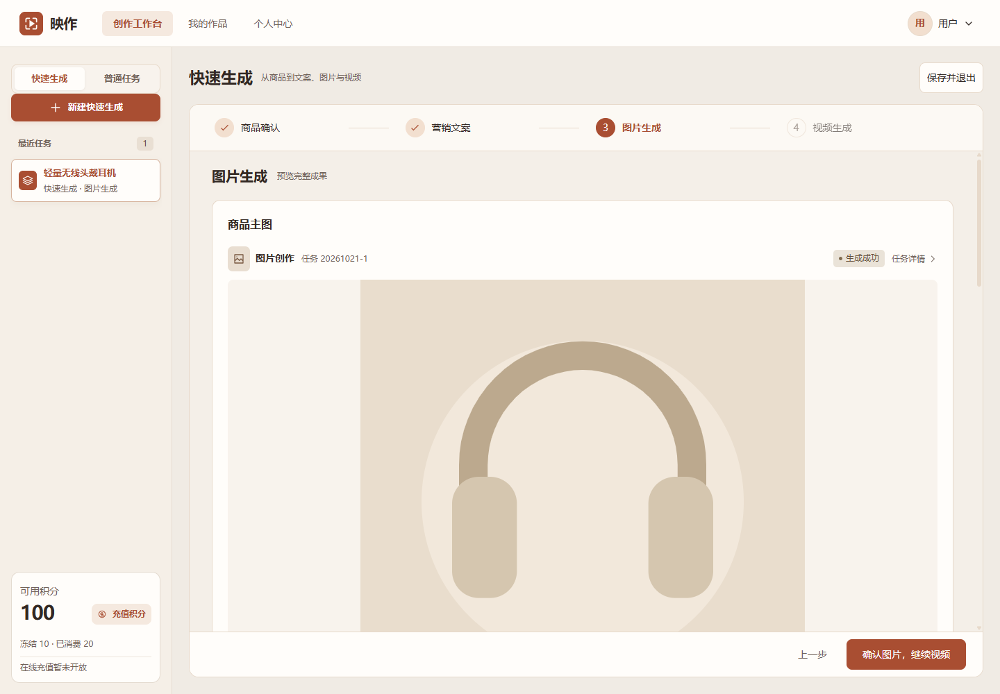
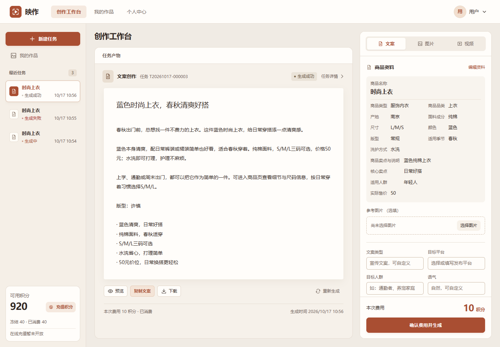

<p align="center">
  
</p>

# 映作 · 电商 AI 创作平台

把商品资料、创作指令和生成成果放在同一个工作台。支持分步完成文案、图片与视频的**快速生成**，也可通过**普通任务**单独创作；任务、作品与积分记录统一管理。

[界面预览](#界面预览) · [核心能力](#核心能力) · [本地启动](#本地启动) · [技术结构](#技术结构) · [项目文档](#项目文档)

## 界面预览

**快速生成 · 文案确认** — 围绕同一份商品资料，查看和编辑文案，再继续图片创作。

<p align="center">
  <a href="assets/readme/quick-copy.png"></a>
</p>

点击截图查看原图。以上为实际前端组件的合成界面测试截图，商品、文案、余额与费用均为测试数据；不代表客户案例或真实模型效果。详见[本次界面验证](docs/verification/quick-generation-ui-v1.1-2026-10-21.md)。

<details>
<summary>查看更多：图片成果与普通任务工作台</summary>

**快速生成 · 图片成果** — 展示完整图片，确认后继续视频步骤。

<a href="assets/readme/quick-images.png"></a>

**普通任务 · 文案创作** — 商品资料、创作参数与成果阅读分区展示。

<a href="assets/readme/workspace.png"></a>

截图分别来自 2026-10-21 与 2026-10-17 的界面验证，均使用测试数据。[素材来源](assets/readme/README.md)

</details>

## 核心能力

| 创作环节 | 可以做什么 |
| --- | --- |
| 商品资料 | 保存商品信息与参考图片，让创作围绕明确的商品内容展开 |
| 文案创作 | 配置文案类型、平台与语气，使用 AI 辅助完善指令，预览、复制和下载正文 |
| 图片创作 | 按平台与用途生成商品图片，预览完整成果并查看历史版本 |
| 视频创作 | 提交商品与首帧资料，查看或修改方案，显式确认后生成视频 |
| 任务与作品 | 查看持久化进度、恢复已有任务、管理和下载自己的成果 |
| 账户与后台 | 查看积分及流水，管理用户、Agent 连接、生成参数和审计记录 |

快速生成按 **商品确认 → 营销文案 → 图片生成 → 视频生成 → 完成汇总** 推进，关键步骤保留确认。普通任务用于独立选择文案、图片或视频创作。

平台负责账户、权限、任务、作品和积分；三个独立 Agent 服务负责生成。已受理任务保留原输入与费用快照，完整成果保存后结算，刷新页面继续读取原任务。

> **当前阶段：本地开发与专项验证。** 文案、图片、视频已有 HTTP 接入及各自的验证记录；具体环境的可用能力取决于服务连接、模型和业务配置。首版充值为说明页，尚未接入真实支付；本仓库不代表完整首版或生产验收通过。

## 本地启动

从仓库根目录执行以下命令。需要 **Python 3.12、uv、Node.js ≥ 22.14、pnpm 11.25.0、MySQL 8.4 和 Redis 7.4**。生成还依赖独立的 `textAgent`、`imageAgent`、`videoAgent` 服务，本仓库不包含这三个服务的完整部署。

### 1. 安装依赖

```powershell
uv sync --frozen --project backend
pnpm --dir frontend install --frozen-lockfile
```

没有可复用的本地数据服务时，在独立终端启动开发依赖：

```powershell
docker compose -f infra/compose.dev.yaml up
```

先核对已有服务及端口。默认 MySQL 为 `13306`，Redis 为 `16379`；Windows / WSL 环境说明见[工程入口](docs/development/t01-bootstrap.md)。

### 2. 配置并迁移数据库

```powershell
# 仅首次复制，保留已有配置。
if (-not (Test-Path backend/.env)) {
    Copy-Item backend/.env.example backend/.env
}
```

编辑 `backend/.env` 中的本地数据库、Redis 和 `APP_STORAGE_ROOT`，并创建该配置指定的绝对存储目录。API、Alembic 与 Worker 自动读取这份文件；环境变量优先。`backend/.env` 与本地数据不提交 Git，`TEST_DATABASE_URL` 必须指向独立测试库。

确认连接目标为本地开发库后，首次启动或新增迁移时执行：

```powershell
uv run --frozen --project backend alembic -c backend/alembic.ini upgrade head
```

### 3. 启动服务

**Windows 完整本地环境：** 在同级目录准备三个 Agent 的虚拟环境与配置后，双击 [启动后端.cmd](启动后端.cmd)，或执行：

```powershell
.\infra\scripts\restart-api.ps1
```

启动器检查数据服务，启动或复用 Agent API、视频 Worker、Web API 与平台 Worker。它不会代替首次安装和迁移；Worker 启动后会继续处理已受理任务。[启动器参数与运行细节](docs/development/readme-history-2026-10-21.md#本地启动)

然后在另一个终端启动前端：

```powershell
pnpm --dir frontend dev
```

打开 [http://127.0.0.1:15173](http://127.0.0.1:15173)。Vite 将 `/api` 代理到 `127.0.0.1:18000`，可通过 `API_PROXY_TARGET` 调整；不要把秘密放入 `VITE_*`。

<details>
<summary>仅启动 Web API，以及健康检查</summary>

需要单独调试 Web API 时运行：

```powershell
uv run --frozen --project backend uvicorn app.main:application --factory --app-dir backend --host 127.0.0.1 --port 18000
```

该命令不会启动 Agent 或平台 Worker，不能独立完成生成任务。

- 存活检查：`GET /api/v1/health/live`
- 就绪检查：`GET /api/v1/health/ready`，检查数据库、迁移版本与持久目录；旧版本数据库返回 503。
- 启动器预演：`.\infra\scripts\restart-api.ps1 -WhatIf`
- 仅检查并补齐服务后返回：`.\infra\scripts\restart-api.ps1 -Check`

</details>

### 4. 配置生成能力

在后台 **Agent 配置** 中设置文本、图片、视频服务连接及各自模型；在 **参数配置** 中设置创作价格。模型供应商密钥由各自 Agent 管理，平台服务密钥由后端加密保存。部署前配置持久的加密主密钥，详见[环境示例](backend/.env.example)和[服务连接说明](docs/verification/text-service-connection-2026-10-15.md)。

**服务启动不等于业务已开放。** 空库还需配置注册、生成等业务政策；保存模型不自动启用生成。身份 Cookie 使用 Secure，写操作校验 Origin 与 CSRF；部署需 HTTPS 同源代理及精确的 `APP_AUTH_ORIGINS`。本机 loopback 配置、测试积分和 TEST_ONLY 数据不能直接用作生产默认。

## 技术结构

```text
Vue 3 / TypeScript / Element Plus
                 │ 同源 API · SSE 任务事件
                 ▼
          FastAPI 平台后端
            ├─ MySQL：账户、任务、作品与积分事实
            ├─ Redis Streams：任务调度 → 平台 Worker
            ├─ 本地硬盘：受控素材与成果存储
            └─ HTTP：textAgent / imageAgent / videoAgent
```

| 目录 | 内容与入口 |
| --- | --- |
| [`frontend/`](frontend) | Vue 3、TypeScript、Vite、Element Plus；[页面路由](frontend/src/router.ts)与[前端说明](frontend/README.md) |
| [`backend/`](backend) | Python 3.12、FastAPI、SQLAlchemy、Alembic；[API 入口](backend/app/main.py)、[Agent 适配](backend/app/agents)、[数据库迁移](backend/migrations/versions) |
| [`contracts/`](contracts) | [OpenAPI](contracts/openapi.json)、[Agent 协议](contracts/agents)与[政策边界](contracts/policies/README.md) |
| [`infra/`](infra) | [开发 Compose](infra/compose.dev.yaml)、[环境示例](infra/env.example)、[运维手册](infra/runbooks) |
| [`docs/`](docs) | 需求、设计、实施计划与专项验证记录 |

## 项目文档

| 想了解什么 | 从这里开始 |
| --- | --- |
| 产品范围与已确认设计 | [需求终稿](docs/电商AI创作平台-首版需求终稿-2026-10-09.md) · [产品设计入口及后续变更](docs/product-design.md) · [V2 视觉基准](docs/design/high-fidelity-2026-10-11/visual-reference.md) |
| 页面开发与共享组件 | [前端说明](frontend/README.md) · [公共控件约定](docs/development/frontend-ui.md) |
| 文案、图片、视频接入证据 | [文案真实链路](docs/verification/local-text-generation-2026-10-16.md) · [图片配置与受理核查](docs/verification/local-image-generation-2026-10-16.md) · [视频真实链路](docs/verification/local-video-generation-2026-10-17.md) |
| 快速生成与工作台 | [快速生成验证](docs/verification/quick-generation-2026-10-18.md) · [新版界面验证](docs/verification/quick-generation-ui-v1.1-2026-10-21.md) · [工作台重设计](docs/verification/workspace-redesign-2026-10-17.md) |
| 验收与上线 | [交付待办](docs/release-checklist.md) · [AC-01～30 追踪](docs/verification/acceptance.csv) · [全部专项记录](docs/verification) |
| 历史运行与排障细节 | [美化前 README 归档](docs/development/readme-history-2026-10-21.md) · [历史开发范围](docs/development-scope-2026-10-13.md) |

验证记录按日期说明实际检查、已知失败与未验范围；历史测试数字不代表当前全量回归状态。真实 Agent 联调、完整故障矩阵、生产政策与备份恢复应分别验收。
