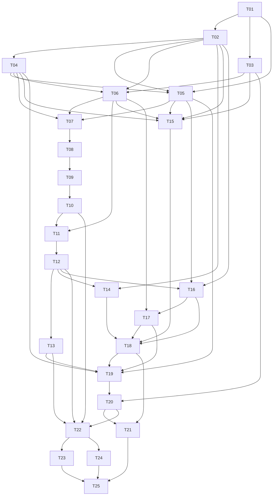

# 电商 AI 创作平台 Implementation Plan

> **For agentic workers:** REQUIRED SUB-SKILL: Use superpowers:subagent-driven-development (recommended) or superpowers:executing-plans to implement this plan task-by-task. Steps use checkbox (`- [ ]`) syntax for tracking.

**Goal:** 按终稿构建账户、三个独立 Agent、统一创作窗口、可恢复任务、作品与测试积分消费平台。本文件只交付开发计划，不表示实现或验收通过。

**Architecture:** 单个 Python 业务项目提供 API 和独立 Worker 进程，三个 Agent 独立服务。MySQL 是任务、状态、账本与派发恢复的事实来源；事务 Outbox 驱动 Redis 调度，服务器文件完整持久化后再由数据库事务发布成果和结算。Vue3 前端通过受保护接口与通知呈现持久状态，连接生命周期不控制任务。

**Tech Stack:** 已确认 Python、Vue3、MySQL、Redis、服务器硬盘。实现建议 Python 3.12、FastAPI、Pydantic2、SQLAlchemy2、Alembic、MySQL8.4 LTS、Redis7.4、Vue3+TypeScript+Vite、pytest、Vitest、Playwright；T01 锁定兼容补丁版本，建议版本不冒充用户确认。Worker 建议 Redis Streams 薄调度器+MySQL 恢复循环，Celery 是替代候选，T01 记录选择且保持恢复契约。

**Spec:** [首版需求终稿 V1.0](../../电商AI创作平台-首版需求终稿-2026-10-09.md)，2026-10-09，唯一需求基线。当前无产品源码，以下文件、API 与表均拟新建。

**实施前修订（2026-10-11）：** 用户确认技术栈并授权先评估、修正本计划后按任务渐进实施。当前界面必须先读取 [项目设计资料](../../product-design.md) 和 [V2 暖色视觉基准](../../design/high-fidelity-2026-10-11/visual-reference.md)：使用奶油米色＋陶土橙的共享 token，历史绿色原型仅提供交互参考。执行安排与评审结论见 [分阶段执行说明](../../development/2026-10-11-execution.md)。保留 T01～T25 编号，下面已补齐基础写入者归属、鉴权依赖、个人资料和后台积分契约，并将生命周期浏览器验收移到用户页面实现后。

## Global Constraints

- 开放账号密码注册，不增加手机号、邮箱验证等前置步骤。
- 统一聊天窗口，用户手动选择 Agent。
- 注册赠送试用积分，管理员可以追加；数量、价格、辅助方案依 D-05 确认。
- 首版提供充值入口和说明页，不执行真实充值，不建订单、不调支付渠道、不增加积分。
- 首版使用服务器硬盘保存素材与作品，暂不接入云对象存储。
- 电脑端为主，手机端做基本响应式适配。
- 三个 Agent 都通过重新生成获得新结果，首版不做局部编辑。
- MySQL 是任务与积分的事实来源；Redis 只负责缓存、限流、调度，不存唯一任务或账本。
- D-01～D-12 未满足的生产能力保持不可用；mock 数值显式 TEST_ONLY，不作为生产政策。
- 不增加自动路由/串联、批量生成、团队协作、电商发布、独立视频脚本或长详情页排版编辑器。
- 常规管理员不默认获得用户内容权限；秘密不进入响应、快照、错误日志。
- 暂未查到、超时、期限届满、断线、保存失败均不是确定生成失败证据。

## Review Focus

1. 调价后同幂等键重放仍返回原任务：T07 `test_replay_after_reprice_returns_original`，不再次冻结；改变输入/报价拒绝。
2. 上游受理后响应丢失、查询暂未找到：T09 `test_not_found_is_not_safe_retry`，仍待核查；安全证据才复用原标识恢复。
3. 完整文件落盘后数据库发布失败：T11 `test_disk_complete_db_commit_failure`，恢复原保存记录，生成意图不增加。
4. 人工释放后迟到成功：T13 `test_late_success_after_release`，终态不逆转、不自动补扣，只登记冲突。
5. SSE 跨用户重连/撤销会话/未持久片段：T14 `test_sse_cross_user_and_revoked_session` 与 T18 重连场景，每次鉴权、读取持久状态，不重提或把片段变成果。

---

## 1. 边界、项目结构与模块职责

本次授权只产原型和计划，以下勾选框尚未实施。原型入口 [docs/prototype/index.html](../../prototype/index.html)，映射以中文页面名定位，不虚构 hash。独立模块 T01～T25 各自测试和评审后交付；负责人类型是建议，实施前指定真人。每任务提交相关文件、测试、契约和验证证据，建议提交信息 `feat(Txx): <行为>`。

```text
backend/pyproject.toml, uv.lock, alembic.ini, migrations/versions/
backend/app/{main,config,db}.py                 # 启动、门槛、事务与锁顺序
backend/app/common/{types,errors,security,redaction}.py
backend/app/policies/{models,service,schemas,routes}.py
backend/app/auth/{models,service,schemas,routes,dependencies}.py
backend/app/ledger/{models,service,schemas,routes,reconcile}.py
backend/app/catalog/{models,service,schemas,routes}.py
backend/app/conversations/{models,service,schemas,routes}.py
backend/app/storage/{models,capacity,local_store,validation,download,routes}.py
backend/app/tasks/{models,schemas,routes,admission,state_machine,repository}.py
backend/app/dispatch/{models,outbox,consumer,recovery}.py
backend/app/agents/{contracts,registry,mock,copy_adapter,image_adapter,video_adapter,callbacks}.py
backend/app/results/{models,manifest,persistence,publisher}.py
backend/app/investigations/{models,service,schemas,routes}.py
backend/app/events/{models,service,routes}.py
backend/app/assist/{models,service,schemas,routes}.py
backend/app/works/{models,service,schemas,routes,lifecycle}.py
backend/app/admin/{permissions,content_access,statistics,routes}.py
backend/app/site/{models,service,schemas,routes}.py
backend/app/audit/{models,service}.py
backend/worker/main.py                         # 消费、轮询、保存、阶段恢复
backend/tests/{unit,integration,contract,faults,acceptance}/
frontend/{package.json,pnpm-lock.yaml,tsconfig.json,vite.config.ts}
frontend/src/{main.ts,router/index.ts,types/contracts.ts}
frontend/src/api/{client,auth,catalog,tasks,files,works,account,admin,site,assist}.ts
frontend/src/components/{AppShell,AgentSelector,SpecForm,QuotePanel,TaskCard,ResultViewer}.vue
frontend/src/features/{auth,workspace,works,account,admin,site}/
frontend/tests/{unit,e2e}/
contracts/openapi.json                        # 平台 DTO；前端类型生成来源
contracts/agents/{copy,image,video}/v1.yaml   # 真实协议确认前保持 draft
contracts/policies/D-01.yaml ... D-12.yaml    # 版本、确认人/日期/证据，不存秘密
contracts/fixtures/{agents,policies}/         # 明确 TEST_ONLY
infra/{compose.dev.yaml,compose.staging.yaml,nginx.conf,env.example}
infra/scripts/{backup.ps1,restore.ps1,verify_storage.py,reconcile.py,smoke.py}
infra/runbooks/{deploy,rollback,recovery,incident}.md
```

路由/服务/模型按业务模块聚合，禁止 API 直接改余额或前端直接调用 Agent。T18/T19 列实际 Vue 文件名。所有存储内部路径、正文与秘密只通过受控服务访问。

## 2. 数据模型与约束

业务 ID 建议 UUID；积分/字节用整数，价格不用浮点。MySQL InnoDB 事务、外键、唯一索引、CHECK 和 CAS 保证正确性，不依赖 Redis 锁。统一锁顺序 `users -> credit_accounts -> storage_pools -> storage_accounts -> generation_tasks -> reservations`，跨模块共享 Session，不自行提前 commit。死锁只重试没有外部调用的本地事务。

| 表 | 关键字段与约束 |
| --- | --- |
| users/auth_sessions | account_normalized 唯一、password_hash、role/status/auth_version；session_id 唯一、expires/revoked/auth_version；退出撤销当前会话，停用递增版本撤销全部 |
| registration_receipts | request_key 唯一、user_id、account_normalized；相同键重试须账号一致且验证同一密码后返回原账户结果，不再发放；异体冲突，不保存明文密码或可离线猜测的普通密码摘要 |
| decision_versions/audit_events | decision_id+version 唯一、draft/confirmed、owner/at/evidence；审计只追加 actor/object/reason/time/脱敏变更，不存秘密 |
| credit_accounts | user_id 主键，available/frozen/consumed/credited_total 全部>=0；CHECK available+frozen+consumed=credited_total |
| credit_grants | kind+business_key 唯一；注册 key=`signup:<user_id>`，管理员 key 为一次发放意图；amount/reason/actor/time |
| credit_reservations | task_id 唯一、amount、state=frozen/consumed/released、version；只从 frozen 转一种终态 |
| credit_ledger | operation_key 唯一、grant/reservation/task关联、类型/金额/三余额 before-after/time/说明；与账户变更同事务 |
| agent_versions | agent_id+version 唯一、kind/capabilities/endpoint/secret_ref/enabled；已使用版本不可覆盖，查询只返回 secret configured |
| generation_specs/price_versions | spec_id+version 唯一、输入/参数schema、agent_version、delivery_policy；价格版本不可变，credits/enabled；多结果/详情图有门槛 |
| conversations/product_versions/messages | 全部 user_id 隔离；product_id+version 不可变；消息 role/task/kind=authored或final，片段不混入final |
| files/file_refs | 随机id、user/version、internal_path唯一、actual_mime/bytes/hash/state/deleted；file+version+ref_type+ref_id唯一，保护在途/消息/作品引用 |
| storage_pools/storage_accounts | 单行锁/CAS分配预算、reserved/actual/quota，不超确认账户/服务器预算；真实磁盘不足仍必须拒绝 |
| capacity_reservations | task或upload_id唯一、estimate/actual/state/policy/expires；回收幂等，异常期限依 D-08/10 |
| generation_tasks | user_id+idempotency_key唯一、request_hash、input_snapshot、Agent/规格/价格/政策版本、费用、external_submission_id唯一、upstream_id、state/version、lease/fencing；agent_id+upstream_id唯一（未绑定NULL） |
| task_state_events/dispatch_outbox | task+state_version唯一、from/to/evidence/time；outbox event_id唯一、task/operation/ready/attempt/dispatched，受理事务内写入 |
| upstream_attempts/callback_receipts | task/externalID/调用阶段/摘要/受理证据；agent_version+event_id唯一，nonce/hash/绑定task；凭据不入库日志 |
| result_manifests/result_save_jobs | task+manifest_version唯一、预期items/原定位/hash/交付政策；task+item_key唯一、staging/durable/hash/bytes/state/error/recovery |
| works/work_items | task+result_set唯一、user/kind/conversation/manifest；item_key唯一，发布只引用 durable文件或完整文案 |
| investigations/durable_events | 核查owner/deadline/policy/evidence/reason/resolution/actor/time；user+event_seq唯一，公共payload脱敏，业务发布同事务写事件 |
| assist_requests | user+request_key唯一、original/proposed/policy/status，与生成任务分离；独立额度表只在 D-05 选择方案后迁移 |
| content_access_grants/public_cases | 独立内容授权actor/scope/approver/reason/expires/revoked；案例source_work/owner/authorization/public_copy/publish/withdraw_policy，私有归属不变 |
| site_content_versions | content_id+version唯一、product_intro/agent_descriptions/process_steps、draft/approved、policy_version、actor/time；更新CAS新版本，公开只读D-11确认的approved版本，旧版本不可覆盖 |

迁移测试验证真实约束生效，不以 ORM 校验代替。成本未知存 NULL+unavailable，不用0冒充实际成本。保留/审计期限由相应 D 确认。

## 3. 平台类型、API 和错误契约

拟平台契约不等于 Agent 已确认协议。T01 在 common/types.py 定义并生成 OpenAPI/前端类型；日期带时区，分页 cursor/limit，ID 不能代替鉴权。

- `Principal(user_id:UUID,role:UserRole,session_id:UUID,auth_version:int)`。
- `InputSnapshot(product_version:str,product:dict,instruction:str,material_versions:list[FileVersionRef],parameters:dict)`：不含秘密，不自动携带会话全文。
- `Quote(spec_id:UUID,spec_version:str,price_version:str,agent_version:str,policy_versions:dict[str,str],credits:int,input_digest:str)`；输入/参数修改须重新报价确认。
- `SubmitTaskRequest(conversation_id:UUID,agent_id:UUID,input:InputSnapshot,confirmed_quote:Quote)`；Idempotency-Key 为一次生成意图；重试沿用，主动重生成新键。
- `TaskView(task_id:UUID,state:TaskState,state_version:int,settlement_state:SettlementState,quote:Quote,work_ids:list[UUID],investigation_reason:str|None)`；未授权诊断不含 input，不返回内部路径/秘密。
- `AdmissionResult(task:TaskView,replayed:bool)`：新受理201、重放200，同task_id；改变内容409 IDEMPOTENCY_CONFLICT。
- 409 QUOTE_STALE 附当前可用报价，不自动受理；422 INPUT_INVALID/SPEC_DISABLED；402 INSUFFICIENT_CREDITS；409 CAPACITY_INSUFFICIENT；403 FEATURE_NOT_ENABLED；429 RATE_LIMITED。错误含trace_id、安全说明，不泄露别人资源或秘密。
- 已确认报价因调价、规格改版或下架失效时统一409 QUOTE_STALE，并返回当前有效报价/规格（无替代时为空集合）；422 SPEC_DISABLED仅用于没有已确认有效旧报价的新请求。各客户端按此区分补资料与重新确认。
- 本人 TaskDetail/ConversationView/WorkSource 提供不可变来源输入/素材版本/原报价以支持详情和重新生成；管理员普通诊断仍不返回这些用户正文。路由创建时即完成资源所有权保护，T16只统一登记与回归，不延期鉴权。
- 无登录401；跨账户统一404；后台缺内容授权403。

以下前缀均 `/api/v1`，全部拟新建。

| 路由 | 服务行为 |
| --- | --- |
| POST /auth/register,/auth/login,/auth/logout；GET/PATCH /me | RegisterRequest(account,password,request_key)，安全cookie会话，退出 revoke_session；本人资料 ProfileUpdate 仅可更新昵称（1～80字，可空表示未设置）及非必填简介（最多500字），不能修改角色、账号、余额；无手机邮箱验证 |
| GET /account,/account/ledger | 本人三余额、累计入账、冻结去向流水与原因 |
| GET /agents,/agents/{id}/specs；POST /quotes | 只返回启用/支持字段，quote_generation 服务端独立核价 |
| POST/GET /conversations；GET /conversations/{id}；POST /products/versions | 本人历史与持久任务/消息、不可变资料版本；不默认提供会话删除 |
| POST /files；GET /files/{id}/content；DELETE /files/{id} | 真实类型/大小校验、本人受控预览/Range下载，删除依D-09 |
| POST /tasks；GET /tasks/{id},/tasks?conversation_id= | admit_task；读取持久记录，不靠前端状态 |
| GET /events?after= | cookie鉴权SSE、Last-Event-ID补偿；过期reset→GET任务，不能POST重提 |
| POST /assist/prompts | request_key/Agent/资料/指令/素材/参数→草案、缺事实提示、政策版本；不建生成任务 |
| GET /works,/works/{id}；DELETE /works/{id} | 本人按类型筛选/完整成果，删除门槛 |
| GET /site/content,/site/cases | 只公开已批准文案与副本，不暴露私有原文件 |
| GET/PATCH /admin/site/content | 管理员读取当前草稿/批准版；SiteContentUpdate(expected_version,content,policy_version)经update_site_content写新版本及脱敏审计；D-11未确认仅保存草稿，不能公开 |
| POST /agent-callbacks/{agent_id}/{version} | D-01签名/凭据/时间/nonce/eventID及绑定验证；不接受任意user |
| GET /admin/users；PATCH /admin/users/{id}/status；POST /admin/credit-grants | 停用D-09；发放key/amount/reason必填、幂等 |
| GET /admin/users/{id}/account,/admin/users/{id}/ledger | 管理员查看指定用户的积分余额与分页流水；只返回账本必要信息，不包含用户素材、作品或消息正文 |
| GET/PATCH /admin/registration-credit-config | 注册赠送整数配置及不可变版本；更新包含 expected_version、amount、D-05 policy_version、reason，CAS冲突409；生产D-05未确认不可启用，修改只影响后续注册，不追补旧用户；变更有审计 |
| GET/POST /admin/agents,/admin/specs,/admin/prices | 新版本、脱敏secret、变更审计，不覆盖历史 |
| GET /admin/tasks,/admin/tasks/{id}/diagnostics | 默认仅必要阶段/错误/耗时/用量，不返回正文 |
| POST /admin/tasks/{id}/investigations,/admin/tasks/{id}/resolutions | action=resume_original/confirm_failure/manual_close，决策版本+证据+原因；不绕过交付/账本 |
| POST /admin/content-access-grants；GET /admin/content/{resource_type}/{id} | 单独授权由具备授予权限的批准者建立；读取内容理由/对象/人/时间审计 |
| GET /admin/statistics,/admin/audit；GET/POST /admin/site/cases；POST /admin/site/cases/{id}/withdraw | 不可得成本显示unavailable；授权真实案例与撤回政策 |
| GET /health/live,/health/ready | 校验DB、持久根和配置；Redis故障不代表任务不存在 |

无支付订单/渠道/确认/充值加积分API；充值说明只 GET /account。注册赠送与管理员发放不统计为支付收入。

## 4. 事务、状态、恢复和文件发布契约

### 4.1 四个原子边界

注册：同事务创建user、credit account、唯一signup grant、ledger；相同注册请求重试不再赠送。赠送配置无D-05确认则生产注册门槛未满足，mock可用TEST_ONLY。

受理：先按user+key查原任务并比对规范化request_hash，同内容直接返回原任务（调价后亦然），不同内容拒绝；仅新键才验账号/Agent/规格/报价/决策/素材/并发/容量。同事务创建固定快照任务、冻结/流水、容量预留、在途引用、outbox与事件；失败全部回滚，未使用预留按唯一admission_id回收；提交前不得调用上游。

成功：`publish_and_settle(session,task_id,manifest_id,expected_version) -> TaskView` 校验完整durable交付、政策与最终消息，同事务发布作品/消息、CAS成功、冻结→消费、余额/唯一流水、容量核算/事件。DB失败保留recoverable文件，不能再生成。

确定失败/允许关闭：同锁顺序从frozen→released，余额/唯一流水原子；消费与释放竞争仅一个终态。人工关闭依D-08，不代表上游失败，无完整交付证据禁止消费。

账本服务不自行commit：`grant_credits(session,user_id,kind,business_key,amount,reason,actor)->GrantReceipt`；`freeze_credits(session,user_id,task_id,amount)->Reservation`；`settle_credits(session,task_id,delivery_evidence)->SettlementReceipt`；`release_credits(session,task_id,failure_or_policy_evidence)->SettlementReceipt`。API不得直接改余额，每变更必有一条对应流水。

### 4.2 状态和持久CAS

TaskState：SUBMITTED已提交、QUEUED排队中、SUBMITTING提交上游中、RUNNING执行中、INVESTIGATING待核查、SAVING结果保存中、SAVE_RECOVERY保存失败待恢复、SUCCEEDED成功、FAILED失败、MANUALLY_CLOSED人工关闭。独立 SettlementState：FROZEN/CONSUMED/RELEASED。`transition_task(session,task_id,expected_version,event,evidence)->TransitionReceipt` 持久CAS并写状态事件。

| 当前 | 允许目标及条件 |
| --- | --- |
| SUBMITTED/QUEUED | QUEUED/SUBMITTING；确定失败证据才FAILED；调用前持久external_submission_id |
| SUBMITTING | 可验证受理RUNNING/完整结果SAVING/受理不明INVESTIGATING/确定失败FAILED |
| RUNNING | SAVING/INVESTIGATING/确定失败FAILED；查原任务，查单失败不能重发 |
| INVESTIGATING | 证据恢复RUNNING/SAVING；可靠幂等或可靠未受理证明才SUBMITTING（需调度先QUEUED）；确定失败FAILED/政策允许MANUALLY_CLOSED；沿用原task/externalID/快照/冻结 |
| SAVING | 完整持久并原子发布SUCCEEDED；异常SAVE_RECOVERY |
| SAVE_RECOVERY | 仅原结果恢复SAVING；无法恢复INVESTIGATING；政策允许MANUALLY_CLOSED |
| SUCCEEDED/FAILED/MANUALLY_CLOSED | 保持终态，只追加迟到/冲突审计，不逆转或补扣 |

INVESTIGATING/SAVE_RECOVERY均不结算。已有upstream ID优先查原；暂未查到不等于可靠证明未受理。上游通知/临时链接/文案片段不足以成功。

### 4.3 Outbox与上游边界

`enqueue_outbox(session,task_id,operation)->OutboxEvent` 与受理共享事务。dispatcher可重复推event_id；Worker经DB lease/fencing token/CAS领取更新。派发后周期扫描阶段/过期租约补调度，因此Redis全丢、消息确认后Worker崩溃也可恢复。补调度恢复handler，不能直接submit。

AgentAdapter：`submit(snapshot,external_submission_id)->SubmitOutcome`、`query_by_external(external_submission_id)->QueryOutcome`、`query(upstream_task_id)->QueryOutcome`、`verify_callback(raw,headers)->VerifiedEvent`、`retrieve_original(locator)->ResultSource`。UNSUPPORTED、NOT_FOUND、PROVEN_NOT_ACCEPTED分离；后者必须D-01协议证明一致性/覆盖期，普通404/空列表/暂查不到不能创建 SafeRetryEvidence。

`SafeRetryEvidence(protocol_version,kind,reference,verified_by,verified_at)` 只表示可靠幂等或可靠未受理证据。调用前持久attempt/原externalID，取得upstream ID及时绑定唯一索引；重启先查原ID或外部ID。缺能力且受理不明→核查，不重发、不释放/扣费；租约过期不证明上游没有在途调用。回调/轮询同归一化状态机，乱序/跨任务/跨Agent/重复只拒绝或留冲突，不能倒退。

### 4.4 文件与结果

LocalStore只接受随机fileID/内部路径。持久卷内staging写入→实际类型/大小/hash验证→fsync文件→同文件系统atomic rename到durable→fsync目录→记录save job证据→DB发布/结算。T24验证目标平台语义；不支持时评审等效持久方案，普通写成功不等于持久。

save job保留原locator/item_key/交付政策/下载证据。中断后完整durable文件恢复入库，不完整只重取原结果；不能用新生成冒充恢复。链接失效且原upstream不能恢复→核查。孤立文件仅在保留/引用保护满足后清理，正在恢复的文件不能删。完整文案与最终message/work原子发布，片段临时缓冲不计费。

仅批准Agent来源可下载，禁止任意用户URL。校验协议/主机/端口、DNS和实际连接IP及每跳重定向，拒绝回环/链路本地/云元数据/未批准内网、IPv6/映射绕过；按D-10流式限制字节/时限/跳数。网络出站限制辅助防护，不能替代应用校验。

## 5. 阶段与任务依赖DAG



阶段：T01～03契约/mock；T04～07账户账本/受理；T08～14恢复/发布/事件；T15～21辅助/作品/页面后台；T22运行基础；T23逐Agent真实联调；T24升级恢复演练；T25总验收。独立模块可在契约完成后并行，账本/状态/发布顺序集成。

| 阶段退出点 | 可核对产物与拦截条件 |
| --- | --- |
| T01～03 | 可启动mock、锁文件/OpenAPI、12份draft决策、三Agent故障模拟器PASS；真实能力仍关闭 |
| T04～07 | 注册/会话/账本/报价/容量/受理并发测试PASS，所有任务快照和Outbox可核对；未决生产参数不启用 |
| T08～14 | Redis全丢及Worker各阶段重启、响应丢失核查、原结果恢复、互斥结算、SSE补偿PASS；任何重复生成/余额差异拦截后续集成 |
| T15～21 | 用户和后台完整路径、辅助撤回、充值无副作用、资源权限/内容单独授权、响应式PASS；官网真实案例与删除等按D门槛 |
| T22～24 | 实际监控告警、三真实Agent分别联调证据、升级与DB文件恢复回滚演练；相应D未确认则BLOCKED |
| T25 | 30项AC逐案证据与独立评审关闭；必需主流程无FAIL/BLOCKED才允许首版上线判定 |

估算仅用于配人：基础5～8人日，账户受理10～15，恢复发布18～27，辅助/页面14～21，运行联调验收10～17，合计57～88人日。假设后端1人、前端1人、测试运维按需，含任务内验证/一次评审修复，不含Agent服务开发、决策等待、支付或新增范围；不承诺日期。

## 6. 独立可测任务

T01建立测试运行环境。仓库根执行 `uv sync --project backend --locked`、`pnpm --dir frontend install --frozen-lockfile`、`docker compose -f infra/compose.dev.yaml up -d mysql redis mock-agent`。以下是实施阶段拟运行命令，目前无源码不可运行；首次RED必须是接口/行为断言失败，不能以环境损坏充数。integration/faults使用独立MySQL测试库，不用SQLite代替事务证明。

### T01 可启动项目、统一DTO和配置
**负责人/前置：** 技术负责人+后端；无。**Files:** 第1节启动/common文件、backend/pyproject.toml与uv.lock、frontend基础配置、contracts/openapi.json、infra/compose.dev.yaml与env.example；测试 `backend/tests/unit/test_bootstrap.py`。
**Interfaces:** `create_app(settings:Settings)->FastAPI`、`get_session()->Iterator[Session]`、`Settings(mode:mock|staging|production,storage_root:Path)`；第3节DTO与前端类型生成命令。
- [ ] 写 `test_production_rejects_test_only`、`test_readiness_requires_persistent_root`：生产测试值拒启，缺持久根ready=false。
- [ ] `uv run --project backend pytest backend/tests/unit/test_bootstrap.py -q` 确认RED。
- [ ] 建启动/配置/DB与mock容器，锁依赖兼容版本；记录Streams/Celery选择与OpenAPI生成规则。
- [ ] 建 Vitest/Playwright 配置与独立测试库约定，明确 webServer/baseURL、健康等待、端口与清理；测试 seed/reset 和故障控制只在 TEST_ONLY 模式使用，不提供生产控制路由。业务页尚未实现时不把缺页或环境错误计为行为 RED。
- [ ] 交付pytest conftest、真实MySQL独立测试库/迁移初始化及隔离清理fixture，后续模块扩展实际表约束；T01无业务迁移时先验证基础连接/事务及迁移环境，不用SQLite代替。
- [ ] 重跑预期PASS；`pnpm --dir frontend typecheck` 退出0，GET live200，mock显式标识。
- [ ] 评审无秘密/生产默认政策，提交锁文件与启动说明。

### T02 决策版本与生产开关
**负责人/前置：** 产品协调+后端；T01。**Files:** policies四文件、contracts/policies/D-01.yaml至D-12.yaml、fixtures/policies/mock.yaml、迁移0001_policy_versions.py；`backend/tests/unit/test_policy_gates.py`。
**Interfaces:** `require_feature(feature,mode,decision_versions)->GateReceipt`、`confirm_decision(actor,id,version,evidence_refs)->DecisionVersion`；初始全部draft。
- [ ] 写 `test_missing_decision_blocks_feature`、`test_count_only_d05_not_assist_policy`、`test_mock_not_production`：403且无副作用。
- [ ] `uv run --project backend pytest backend/tests/unit/test_policy_gates.py -q` 确认RED。
- [ ] 按第8节绑开关；确认必须人/日期/版本/证据，辅助UNDECIDED，不默认独立免费。
- [ ] 重跑PASS；12模板无虚构确认，多结果D-04缺失不上架。
- [ ] 评审变更影响AC，提交，交实际业务负责人填写。

### T03 Agent边界与故障模拟器
**负责人/前置：** Agent接口+后端测试；T01。**Files:** agents/{contracts,registry,mock}.py、三份v1.yaml draft、fixtures/agents/scenarios.yaml；`backend/tests/contract/test_mock_agents.py`。
**Interfaces:** 第4.3节AgentAdapter；Capabilities(sync/async/stream/final_text/idempotent_submit/query_external/query_id/callback/original_result_recovery)。
- [ ] 写 `test_mock_response_loss_preserves_intent`、`test_not_found_differs_proven_absent`：同externalID单有效意图。
- [ ] `uv run --project backend pytest backend/tests/contract/test_mock_agents.py -q` 确认RED。
- [ ] 实现lost_response/repeated/out_of_order/query_unavailable/not_found/partial/expired_link场景；协议未知保持draft。
- [ ] 明确按 external_submission_id 指定故障场景及读取调用计数的 TEST_ONLY 控制协议，供后台/浏览器测试驱动真实任务 API；模拟服务须可独立进程启动，T01 容器先用健康启动骨架，T03 接替完整故障服务。
- [ ] 重跑PASS；故障稳定复现并导出调用计数，不称真实服务支持。
- [ ] 评审mock标识与协议边界，提交。

### T04 账户、会话撤销与原子赠送
**负责人/前置：** 后端；T02。**Files:** auth五文件、ledger/{models,service}.py、audit两文件、迁移0002_auth_credit_base.py；`backend/tests/integration/test_registration.py`、`test_auth_access.py`。
**Interfaces:** `register_account(account,password,request_key,policy_version)->AuthResult`、`authenticate(account,password)->AuthResult`、`require_active_principal(cookie)->Principal`、`revoke_session(id)`；grant_credits、freeze_credits签名第4.1节；`get_profile/update_profile(principal,dto)->ProfileView`，GET/PATCH /me 采用第3节最小可选资料字段。
- [ ] 写 `test_registration_grant_exactly_once`（并发/重试只有user及signup流水各1）、`test_registration_interrupt_rolls_back`、`test_logout_revokes_current_credential`。
- [ ] `uv run --project backend pytest backend/tests/integration/test_registration.py backend/tests/integration/test_auth_access.py -q` 确认RED。
- [ ] 实现账号规范/唯一索引、建议Argon2id、HttpOnly/Secure/SameSite cookie与CSRF、DB会话、限流、原子赠送，不加验证步骤。
- [ ] 同阶段建立 credit_reservations 模型、唯一约束和 freeze_credits 事务写入者；服务不自行 commit，T07消费冻结能力，T12补完整交付结算/释放。建立版本化注册赠送配置持久层和读取服务，T19提供后台修改入口；注册绑定其版本。本人资料保存/刷新持久、拒绝超长或敏感字段，有鉴权和字段校验测试。
- [ ] 重跑PASS；响应无密码/hash，退出cookie受保护访问401，D-05未确认生产注册关闭。
- [ ] 评审D-07恢复只留门槛，提交。

### T05 Agent、规格、价格版本与报价
**负责人/前置：** 后端+Agent接口；T01,T02,T04。**Files:** catalog四文件、0003_catalog.py；`backend/tests/integration/test_catalog_quotes.py`。
**Interfaces:** `publish_agent_version(actor,draft)->AgentVersion`、`publish_spec_version(actor,draft)->SpecVersion`、`set_price_version(actor,spec,credits)->PriceVersion`、`quote_generation(principal,input,spec_id)->Quote`、`validate_confirmed_quote(quote,input)->ValidatedQuote`。
- [ ] 写 `test_quote_stale_after_reprice_delist`、`test_multi_result_requires_d04`、`test_secret_redacted`。
- [ ] `uv run --project backend pytest backend/tests/integration/test_catalog_quotes.py -q` 确认RED。
- [ ] 建不可变版本，按D-02/03支持范围schema，按D-04/05发布门槛，费用服务端算、变更审计。
- [ ] 重跑PASS；旧版本不可受理、历史不可覆盖、secret仅configured。
- [ ] 评审无硬编码生产价格/参数档位，提交。

### T06 上传、本地存储与容量事务
**负责人/前置：** 后端+运维；T02,T03,T04。**Files:** storage/{models,capacity,local_store,validation,routes}.py、0004_storage.py；`backend/tests/integration/test_capacity.py`、`backend/tests/unit/test_upload_validation.py`。
**Interfaces:** `reserve_capacity(session,user_id,intent_id,estimated_bytes,policy_version)->CapacityReservation`、`finalize_capacity(session,id,actual_bytes)`、`release_capacity(session,id)`、`upload_file(principal,stream,display_name)->FileVersionRef`、LocalStore.stage/commit/read。
- [ ] 写 `test_concurrent_capacity_reservation`、`test_rollback_idempotent_reclaim`、`test_magic_mime_path_size`：容量不重配、路径名不影响保存、实际格式限值判定。
- [ ] `uv run --project backend pytest backend/tests/integration/test_capacity.py backend/tests/unit/test_upload_validation.py -q` 确认RED。
- [ ] 建账户/服务器预算锁、随机隔离路径、持久根临时写入与受控Range下载；先预留后实际核算，失败回收。
- [ ] 重跑PASS；D-10未决生产上传关闭，存储目录不静态公开、越界无文件。
- [ ] 评审物理磁盘监测与预算、异常期限仍D-08/10，提交。

### T07 任务受理、快照、幂等和冻结
**负责人/前置：** 后端+DB测试；T04,T05,T06。**Files:** tasks/{models,schemas,routes,admission,repository}.py、dispatch/models.py、conversations四文件、0005_tasks_admission.py；`backend/tests/integration/test_task_admission.py`。
**Interfaces:** `admit_task(principal,key,request)->AdmissionResult`、`create_conversation(principal,title)->Conversation`，消费quote/reserve/freeze。
- [ ] 写 `test_same_key_same_body_one_task`、`test_same_key_changed_body_conflict`、`test_replay_after_reprice_returns_original`、`test_insufficient_interrupt_no_side_effect`、`test_snapshot_immutable_after_edit`，断言余额和任务/outbox/流水/预留/引用计数。
- [ ] `uv run --project backend pytest backend/tests/integration/test_task_admission.py -q` 确认RED。
- [ ] 按第4.1节先查幂等再新受理校验，同事务固定资料/素材/指令/参数/Agent/价格快照、冻结/预留/outbox；不传历史全文。
- [ ] 本任务同时建立 enqueue_outbox 事务写入者（dispatch/outbox.py）和 durable_events 模型/迁移及 append_durable_event（events/models.py、events/service.py）；它们接受同一 Session、不自行 commit，确保受理和后续T12发布可原子写记录。T08补消费/恢复，T14补鉴权流与补偿，不推迟基础表和写入服务。
- [ ] 重跑PASS；同键只一冻，异体409；旧价409无任务/冻结；提交前upstream调用0；新键重生成留旧作。
- [ ] 评审每写点失败注入、唯一索引/锁顺序，提交。

### T08 状态机、Outbox、持久调度恢复
**负责人/前置：** 后端；T07。**Files:** tasks/state_machine.py、dispatch/{outbox,consumer,recovery}.py、backend/worker/main.py、0006_task_recovery.py；`backend/tests/faults/test_dispatch_recovery.py`、`backend/tests/unit/test_state_machine.py`。
**Interfaces:** transition_task签名第4.2节；`claim_task(task_id,worker_id)->Lease`、`dispatch_pending(batch_size)->DispatchReport`、`recover_due_tasks(now)->RecoveryReport`。
- [ ] 写 `test_commit_then_redis_failure`、`test_stream_deleted_ack_then_crash`、`test_two_workers_fencing`、`test_saving_no_regression`。
- [ ] `uv run --project backend pytest backend/tests/faults/test_dispatch_recovery.py backend/tests/unit/test_state_machine.py -q` 确认RED。
- [ ] 实现重复派发、DB lease/fencing/CAS、周期阶段恢复与迁移白名单；过期租约不直接上游重提。
- [ ] 重跑PASS；Redis清空、Worker重启仍同任务恢复，无新冻结，消息非唯一来源。
- [ ] 评审崩溃点、提交恢复手册草稿。

### T09 上游提交证据和安全恢复
**负责人/前置：** 后端+Agent接口；T08。**Files:** agents/{registry,contracts}.py、dispatch/recovery.py、tasks/repository.py、0007_upstream_attempts.py；`backend/tests/faults/test_upstream_recovery.py`。
**Interfaces:** `submit_original_task(task_id,lease)->TaskView`、`recover_original_task(task_id,evidence:SafeRetryEvidence|None)->TaskView`。
- [ ] 写 `test_lost_response_reliable_idempotency`、`test_not_found_is_not_safe_retry`、`test_known_id_queries_original`、`test_crash_before_after_bind`、`test_expired_lease_not_nonacceptance`。
- [ ] `uv run --project backend pytest backend/tests/faults/test_upstream_recovery.py -q` 确认RED。
- [ ] 调用前持久intent/attempt，及时绑ID；可靠证据才SUBMITTING/QUEUED复用原externalID和快照，无证据核查，已有ID查原。
- [ ] 重跑PASS；暂未找到/查询失败submit计数不增，task/冻结各1，只有一个有效生成意图，未结算。
- [ ] 评审协议证据条件，真实未确认仍mock，提交。

### T10 回调鉴权、防重放与轮询
**负责人/前置：** 后端安全+Agent接口；T09。**Files:** agents/{callbacks,copy_adapter,image_adapter,video_adapter}.py、0008_callbacks.py；`backend/tests/integration/test_callbacks.py`、`backend/tests/faults/test_polling.py`。
**Interfaces:** `apply_verified_agent_event(agent_version,event:VerifiedEvent)->EventReceipt`、`poll_original_task(task_id)->TaskView`，消费统一状态机。
- [ ] 写 `test_forged_cross_agent_task`、`test_duplicate_out_of_order_terminal`、`test_query_timeout_no_resubmit`。
- [ ] `uv run --project backend pytest backend/tests/integration/test_callbacks.py backend/tests/faults/test_polling.py -q` 确认RED。
- [ ] 按确认协议验证来源/签名/时间/nonce/eventID，DB防重放，绑定Agent+upstream/externalID，不接受任意user；轮询同事件入口。
- [ ] 重跑PASS；乱序不倒退，终态不逆转/结算，查单失败不新生成，冲突可追溯。
- [ ] 评审密钥轮换/降级与脱敏，提交。

### T11 完整结果、本地落盘和原结果恢复
**负责人/前置：** 后端+存储测试；T06,T10。**Files:** results/{models,manifest,persistence}.py、storage/download.py、0009_results.py；`backend/tests/faults/test_result_persistence.py`、`backend/tests/unit/test_download_ssrf.py`。
**Interfaces:** `prepare_manifest(task_id,outcome)->ResultManifest`、`persist_original_result(task_id,manifest_id)->DurableDelivery`、`validate_result_url(url,source_policy,dns)->ApprovedTarget`。
- [ ] 写 `test_partial_temporary_not_complete`、`test_disk_complete_db_commit_failure`、`test_save_failure_expired_link_never_regenerates`、`test_dns_ipv6_redirect_metadata`。
- [ ] 本任务的DB失败点为文件rename后保存记录提交失败：从稳定文件标识恢复DurableDelivery，不调用未来publisher；T12另注入真实作品/消息/账本发布事务失败并验证原文件恢复发布，两个阶段均不增加submit。
- [ ] `uv run --project backend pytest backend/tests/faults/test_result_persistence.py backend/tests/unit/test_download_ssrf.py -q` 确认RED。
- [ ] 实现第4.4节落盘/save job恢复、完整性D-01/04、下载D-10限制与SSRF防护；本地完整只恢复DB发布。
- [ ] 重跑PASS；上游通知/片段不成功，保存异常不扣；原结果恢复前后submit计数不变，失效不能恢复转核查。
- [ ] 评审durable证据/孤立文件保护，提交。

### T12 发布、结算释放互斥与对账
**负责人/前置：** 后端+DB测试；T11。**Files:** results/publisher.py、works/models.py（works/work_items及task/conversation/user关联）、ledger/{service,reconcile,schemas,routes}.py、0010_publication_settlement.py；`backend/tests/integration/test_settlement.py`、`backend/tests/faults/test_publish_atomicity.py`。
**Interfaces:** publish_and_settle、settle_credits/release_credits第4.1节；`reconcile_accounts(session)->ReconciliationReport`只报告不擅改账。
- [ ] 写 `test_complete_publication_once`、`test_concurrent_settle_release_exclusive`、`test_each_publish_write_interruption`、`test_all_operations_conserve_ledger`。
- [ ] `uv run --project backend pytest backend/tests/integration/test_settlement.py backend/tests/faults/test_publish_atomicity.py -q` 确认RED。
- [ ] 同事务发布work/final message/成功CAS/账本/容量/事件；确定失败才自动释放，多结果消费确认政策、不代定按张扣费。
- [ ] 重跑PASS；成功/失败各自一条流水，竞争仅一种，三余额守恒非负；DB失败可恢复原durable成果。
- [ ] 评审真实数据库约束和对账输出，提交。

### T13 核查、人工处置与迟到成果
**负责人/前置：** 后端+运营；T12。**Files:** investigations四文件、0011_investigations.py；`backend/tests/integration/test_investigations.py`。
**Interfaces:** `open_investigation(task_id,owner,policy_version,evidence)`、`resolve_investigation(actor,task_id,action,evidence,reason,expected_version)->ResolutionReceipt`，调用T09/T12，不自由改账。
- [ ] 写 `test_deadline_requires_owner_not_auto_failure`、`test_no_delivery_no_manual_settle`、`test_late_success_after_release`、`test_missing_policy_blocks_resolution`。
- [ ] `uv run --project backend pytest backend/tests/integration/test_investigations.py -q` 确认RED。
- [ ] 按D-08建立期限/负责人/待办、证据理由人时审计；安全恢复原任务，唯一结算/释放后才人工关闭。
- [ ] 重跑PASS；期限非失败，释放后迟到不逆转/补扣，按确认政策交付；用户能读处置原因。
- [ ] 评审无人负责冻结防护，提交操作手册。

### T14 受保护SSE和断线补偿
**负责人/前置：** 后端+前端；T02,T12。**Files:** events三文件、0012_events.py（仅补流式补偿所需增量，基础表/写入者复用T07）；`backend/tests/integration/test_sse_access.py`。
**Interfaces:** `append_durable_event(session,user_id,task_id,kind,payload)->EventSeq`、`stream_events(principal,after)->AsyncIterator[SSEEvent]`；transient_fragment独立于正式成果。
- [ ] 写 `test_sse_cross_user_and_revoked_session`、`test_reconnect_durable_cursor`、`test_fragment_disconnect_no_settle_cancel`、`test_expired_cursor_reset_get_not_post`。
- [ ] `uv run --project backend pytest backend/tests/integration/test_sse_access.py -q` 确认RED。
- [ ] cookie同源鉴权、active持续检查、持久序号补偿/reset；断线仅GET原任务，片段续传依D-01，未存片段不保证恢复。
- [ ] 重跑PASS；退出/停用当前流关闭，跨用户不泄露，连接不改变任务/冻结。
- [ ] 评审事件保留/脱敏，无token放URL，提交。

### T15 指令辅助与未决额度策略
**负责人/前置：** 后端+产品；T02,T03,T04,T05,T06。**Files:** assist四文件及provider.py（PromptAssistProvider请求/响应契约、mock与真实适配边界）、0013_assist.py；`backend/tests/integration/test_prompt_assist.py`。
**Interfaces:** `prepare_prompt(principal,request,policy_version)->AssistProposal(original,proposed,missing_facts,policy_version)`；D-05确认方案后才实现具体额度。
- [ ] 写 `test_assist_no_generation_task`、`test_original_restore_edit_reoptimize`、`test_no_invented_facts`、`test_d05_unconfirmed_blocks_live`；仅选择独立免费时加幂等扣次/并发/重置测试。
- [ ] `uv run --project backend pytest backend/tests/integration/test_prompt_assist.py -q` 确认RED。
- [ ] 草案保原文可撤回，按当前Agent整理，缺事实提示，不补材质/功效/价格/优惠，不新增脚本产品；基础限流。
- [ ] 辅助provider显式配置、超时/错误/限流及素材归属校验；mock固定样本只用于确定性测试，不能作为真实AI接入。真实供应方/协议/额度未确认时live关闭，T23补辅助真实联调与缺事实样本证据，不擅定服务商。
- [ ] 重跑PASS；正式生成须用户另点并确认报价，辅助不建任务，未决生产403。
- [ ] 评审未代定免费/收费额度，提交。

### T16 本人历史、作品和资源权限
**负责人/前置：** 后端；T02,T05,T12。**Files:** works/{service,schemas,routes}.py、conversations/{service,routes}.py、admin/permissions.py；`backend/tests/integration/test_resource_ownership.py`、`test_works_history.py`。
**Interfaces:** `list_works(principal,kind,cursor)->Page[WorkView]`、`get_conversation(principal,id)->ConversationView`、`authorize_resource(principal,type,id)->ResourceGrant`。
- [ ] 写 `test_guess_other_user_all_resources_files`、`test_copy_preview_play_download_filter`、`test_history_matches_task_ledger_regeneration`。
- [ ] `uv run --project backend pytest backend/tests/integration/test_resource_ownership.py backend/tests/integration/test_works_history.py -q` 确认RED。
- [ ] 所有任务/消息/素材/作品/下载逐资源校验；类型筛选和完整结果；关联会话、任务、冻结去向和处置原因。
- [ ] 重跑PASS；两账户互猜404无泄漏，Range仍鉴权，新生成留旧作费用。
- [ ] 评审资源路由登记/DTO/分页，提交。

### T17 生命周期、在途保护和停用
**负责人/前置：** 后端+产品+运维；T06,T16。**Files:** works/lifecycle.py、storage/models.py、auth/service.py；`backend/tests/integration/test_lifecycle.py`。
**Interfaces:** `delete_work/delete_material(principal,id,policy_version)`、`collect_unreferenced_file(id,policy_version)`、`set_account_status(actor,user_id,status,policy_version)`；会话删除只D-09确认后补契约。
- [ ] 本阶段先完成后端缺素材拒绝/补传恢复的行为验证；跨页面 material-lifecycle.spec.ts 的实现与浏览器 RED/PASS 归属T18，不等待尚未实现的用户页面。
- [ ] 写 `test_inflight_material_protected`、`test_kept_ref_no_physical_cleanup`、`test_deleted_history_links_by_policy`、`test_missing_material_reupload`、`test_disable_revokes_preserves_task_ledger`。
- [ ] `uv run --project backend pytest backend/tests/integration/test_lifecycle.py -q` 确认RED。
- [ ] 按D-09逻辑删除/物理清理分离；停用即禁登录/新受理/受保护访问，保留数据，仅确认政策处理在途，不假定支持取消。
- [ ] 重跑PASS；未知保留规则不自动物理清理，删除列表/历史/旧链接/容量/恢复按版本，在途不清理。
- [ ] 评审与D-08异常衔接、账户恢复，提交。

### T18 用户前端完整流程
**负责人/前置：** 前端+设计+测试；T14,T15,T16,T17。**Files:** main/router/types及api/{client,auth,catalog,tasks,files,works,account,assist}.ts；第1节六components及共享AppDialog/AppDrawer、语义tokens；auth/{LoginView,RegisterView}.vue；workspace/{WorkspaceView,ConversationList,PromptEditor}.vue与useTaskStream.ts；works/WorksView.vue；account/{AccountView,RechargeInfoView}.vue；`frontend/tests/e2e/user-flow.spec.ts`、`material-lifecycle.spec.ts`、`frontend/tests/unit/task-stream.spec.ts`。
**Interfaces:** `useTaskStream(conversationId):{tasks,connectionState,reconnect}`、`submitTask(key,request):Promise<AdmissionResult>`；路由/login,/register,/workspace/:conversationId?,/works,/account,/recharge。
- [ ] 写register_generate_history_recharge、stale_quote_reconfirm、refresh_disconnect_original、assist_restore_draft浏览器用例。增加以下F01～08回归，消费实际API返回ID/快照/流水，不读取编辑器猜测旧任务。
- [ ] 按T18a共享视觉/弹层基础、T18b认证/资料/账户、T18c创作/作品、T18d跨页验收分步实现；共享router/client/生成types保持单一写入者。使用V2 tokens和设计入口的弹层语义：编辑/详情抽屉、居中作品预览/收费删除确认、取消初焦、Escape/Tab隔离、关闭恢复焦点、手机全屏抽屉。AccountView资料抽屉保存后刷新仍存在，取消/Escape不PATCH。
- [ ] `frontend/tests/e2e/material-lifecycle.spec.ts` 写 regenerate_missing_material：作品来源输入带回；原素材404/不可用时提示重传，提交不能创建任务/冻结；补齐后确认当前报价创建一新任务，原成果仍可查。执行 `pnpm --dir frontend exec playwright test tests/e2e/material-lifecycle.spec.ts`，先RED后PASS；D-03输入schema和D-09素材政策仍按确认版，不自行代定。
- [ ] conversation_isolation_inflight：桌面/390px新建空会话无旧卡；至少两历史可切回，原任务ID/执行状态/快照不变，全账户冻结不因导航变动（F01）。
- [ ] immutable_task_snapshot：提交自定义资料/指令/素材版本及参数后逐字段相等；切Agent、编辑草稿、新增任务后旧卡按原task_id读取，原Agent/Quote不变（F02）。
- [ ] assist_preserves_parameters：文案语气、图片用途、视频横竖屏/字幕经预览编辑/取消/采用/撤回保持；确认与快照显示真值。空/非空原指令均可撤回和再次优化，无任务/冻结副作用（F03/F06）。
- [ ] task_ledger_three_agents：mock测试价8/20/60分别受理→待核查/保存恢复→成功及受理→确定失败，卡片费用、账户三余额、每条流水before/after一致；重复通知/状态操作只一结算或释放，未结算保持冻结；片段只文案且无作品（F04）。
- [ ] stale_quote_reconfirm：旧p1拒绝/取消无任务无冻结；接受p2后编辑器→确认→新任务全部p2，原任务仍p1（F05）。
- [ ] generated_work_and_regenerate：三Agent成功各幂等新增一作品，可按来源task/conversation找回并筛选预览复制/播放下载；异常无作品。空会话从作品重新生成显示原输入及关联，空资料/缺素材拒绝无副作用，补齐后新报价只一任务、原作保留（F07/F08，配合T17）。
- [ ] `pnpm --dir frontend exec playwright test tests/e2e/user-flow.spec.ts` 与 `pnpm --dir frontend exec vitest run tests/unit/task-stream.spec.ts` 确认RED。
- [ ] 按原型中文入口实现侧栏历史/手选Agent/动态规格/素材/费用确认/状态/完整结果；片段临时显示，核查/保存恢复不显成功，辅助可撤回。
- [ ] 重跑PASS、typecheck退出0；两个充值入口只GET余额/说明，无订单支付余额变化；重连不新POST，键盘可操作。
- [ ] 评审桌面/手机和门槛文案，提交截图与接口证据。

### T19 后台与内容单独授权
**负责人/前置：** 后端+前端+安全测试；T04,T05,T13,T17,T18（共享鉴权/router/client/弹层）。**Files:** admin/{permissions,content_access,statistics,routes}.py、audit/service.py、0014_content_grants.py；frontend/src/api/admin.ts；frontend/src/features/admin/{UsersView,AgentsView,PricesView,TasksView,AuditView}.vue；`backend/tests/integration/test_admin_access.py`、`frontend/tests/e2e/admin-flow.spec.ts`。
**Interfaces:** `grant_content_access(approver,actor,scope,reason,expires_at)`、`read_user_content(actor,resource,reason)->AuditedContent`；授予权限单独记录，不能自己无条件给自己；`get_statistics()`未知成本unavailable。
积分配置/发放/账本入口集成在既有 `UsersView.vue` 的积分面板；用量统计集成在既有 `TasksView.vue` 的统计面板，调用api/admin.ts的GET /admin/statistics，未知实际成本显示unavailable；不另扩CMS或组件库。
规格管理集成在 `AgentsView.vue` 的规格面板，调用既有 /admin/specs API，包含字段/约束/启用门槛和版本审计；后台编辑/详情复用T18弹层。UsersView调用第3节目标用户积分/流水及注册赠送配置API，不用本人流水或审计替代目标账本。
- [ ] 写 `test_diagnostics_no_body_without_content_grant`、`test_content_audit_reason_revocation`、`test_admin_grant_same_key_once`、`test_secret_not_response_snapshot_logs`。
- [ ] 补目标用户余额/流水、非管理员拒绝、赠送配置CAS冲突/D-05门槛及修改只影响新注册的测试；admin-flow浏览器用例覆盖指定用户查账/幂等发放、赠送配置冲突保留草稿、规格编辑/未决禁止发布、普通诊断与独立内容授权分离。
- [ ] `uv run --project backend pytest backend/tests/integration/test_admin_access.py -q` 与 `pnpm --dir frontend exec playwright test tests/e2e/admin-flow.spec.ts` 确认RED。
- [ ] 普通后台/内容权限分离；积分理由/幂等/流水、配置版本脱敏审计、原任务核查、安全处置；统计赠送/发放非收入。
- [ ] 重跑PASS；授权过期/撤销立即拒绝，内容访问记录对象/原因/人/时间，无来源成本不伪造。
- [ ] 评审全路由授权与日志脱敏，提交。

### T20 官网介绍维护、真实案例授权和撤回
**负责人/前置：** 后端+前端+运营；T03,T19。**Files:** backend/app/site/{models,schemas,service,routes}.py（介绍版本与案例）、0015_public_cases.py（同时建site_content_versions）；frontend/src/api/site.ts、frontend/src/features/site/HomeView.vue、frontend/src/features/admin/SiteView.vue；`backend/tests/integration/test_public_cases.py`、`test_site_content.py`、`frontend/tests/e2e/site-content.spec.ts`。
**Interfaces:** `SiteContent(product_intro:str,agent_descriptions:dict[text|image|video,str],process_steps:list[str])`；`SiteContentUpdate(expected_version:int,content:SiteContent,policy_version:str)`；`SiteContentView(version:int,content:SiteContent,status:draft|approved,policy_version:str)`。GET/PATCH /admin/site/content映射 `get_admin_site_content(actor)`、`update_site_content(actor,expected_version,content,policy_version)->SiteContentView`；模型持久化不可变内容版本、CAS当前指针、操作人/时间/脱敏变更审计，同事务提交。`publish_case(actor,work_id,authorization_ref,policy_version)->PublicCase`、`withdraw_case(actor,case_id,policy_version)`，源私有归属不变。
- [ ] 写 `test_site_content_permission_no_write`：普通用户/访客写入403/401，版本和公开GET不变、无成功变更审计；`test_site_content_version_conflict`：旧expected_version409无覆盖；`test_site_content_approved_public_get`：已确认D-11合法管理员修改后新版本返回、GET /site/content只展示确认批准版；`test_site_content_d11_draft_only`：未决D-11可保存后台草稿但公开GET不新增该内容；`test_site_content_change_audited`：人/对象/时间/版本前后与必要变更有记录，不含凭据或用户私有正文。
- [ ] `uv run --project backend pytest backend/tests/integration/test_site_content.py -q` 与 `pnpm --dir frontend exec playwright test tests/e2e/site-content.spec.ts` 先RED；SiteView.vue加载GET /admin/site/content，绑定介绍/三Agent介绍/流程字段，用api/site.ts的updateSiteContent(dto)提交PATCH及expected_version，409保留编辑草稿并提示重新加载；HomeView.vue调用GET /site/content读取批准版本。浏览器测试合法保存后显示新版本、权限拒绝/冲突不丢草稿、D-11未决内容不在公开首页。
- [ ] 写 `test_mock_unauthorized_case_not_publish`、`test_private_source_not_exposed`、`test_withdraw_copy_by_policy`。
- [ ] `uv run --project backend pytest backend/tests/integration/test_public_cases.py -q` 确认RED。
- [ ] 产品介绍/三Agent/流程/“注册体验”及最小介绍维护；编辑授权不等于D-11公开确认。未确认品牌文案保存为draft，确认政策版本后才批准公开；真实案例留来源/归属/授权，批准副本与撤回处理。
- [ ] 重跑上述三测试文件及案例测试PASS；权限与版本冲突无写入，合法批准修改后公开GET一致，重要变更审计齐全；无私有地址，无mock冒充真实，撤回按版本下架/清理公开副本。
- [ ] 评审品牌公开文案和授权证据，提交。

### T21 响应式和可访问回归
**负责人/前置：** 前端+测试；T18,T20。**Files:** `frontend/tests/e2e/responsive.spec.ts`、`accessibility.spec.ts`，仅按失败修改上述具体Vue文件。
**Interfaces:** 既有路由/API；建议测试1440×900、390×844、768×1024样本，不冒充确认设备下限。
- [ ] 写登录/工作台输入规格任务/作品/账户充值/后台导航的溢出、触控、焦点和标签断言。
- [ ] 专项复核V2暖色、正文对比度、44px控件、窄屏表单先于结果及真实区域宽度、合法长名称、弹层快速关闭重开、辅助与导航焦点连续性、长表格横滑提示；复用原型评审发现作为回归输入。配置desktop/mobile Playwright projects，显式复跑user-flow/material-lifecycle/admin-flow/site-content及本阶段两spec，确保F01～08覆盖两种视口。
- [ ] 在1440px与390px复跑T18的conversation_isolation_inflight、immutable_task_snapshot、assist_preserves_parameters、task_ledger_three_agents、stale_quote_reconfirm、generated_work_and_regenerate；手机新建/至少两历史切换入口可见可操作、旧任务/冻结保持，完整成果进库/来源/重生成可达，账户/充值与任务固定费用一致。模态取消/Escape后无任务或冻结副作用，焦点回触发按钮（F01～08）。
- [ ] `pnpm --dir frontend exec playwright test tests/e2e/responsive.spec.ts tests/e2e/accessibility.spec.ts` 记录失败交互。
- [ ] 完整双端回归命令：`pnpm --dir frontend exec playwright test tests/e2e/user-flow.spec.ts tests/e2e/material-lifecycle.spec.ts tests/e2e/admin-flow.spec.ts tests/e2e/site-content.spec.ts tests/e2e/responsive.spec.ts tests/e2e/accessibility.spec.ts --project=desktop --project=mobile`，记录各project实际运行数量及结果。
- [ ] 修复布局/焦点，桌面主布局、手机基本操作、侧栏可收起，媒体不遮主要操作。
- [ ] 重跑PASS，关键操作可达、无横向遮挡、有可访问名称/可见焦点。
- [ ] 评审中文页面入口/门槛文案，提交。

### T22 持久部署、监控和备份工具
**负责人/前置：** 运维+后端；T10,T12,T13,T20。**Files:** infra/compose.staging.yaml、nginx.conf、五scripts和四runbooks；`backend/tests/integration/test_operations.py`。
**Interfaces:** `backup.ps1 -Destination <path> -Manifest <path>`→DB快照/文件hash清单/cutoff/版本；`restore.ps1 -Manifest <path> -Target <isolated-env>`；reconcile只核对不改账；RPO/RTO/路径/频率由D-12确认。
- [ ] 写 `test_metrics_outbox_investigation_capacity`、`test_backup_detects_missing_file`、`test_deploy_keeps_storage_root`。
- [ ] `uv run --project backend pytest backend/tests/integration/test_operations.py -q` 确认RED。
- [ ] trace/taskID脱敏日志、耗时/成功率/可得成本、Outbox积压/核查期限/保存恢复/账本/容量告警；持久根独立release；一致备份设计。
- [ ] 重跑PASS，实际故障告警、缺文件hash检验失败可检测，未知成本无假统计。
- [ ] 评审D-12未决不生产启用，提交运行手册。

### T23 逐Agent真实联调
**负责人/前置：** Agent接口+后端+测试；T22及对应D-01～05/08/09/10。**Files:** 三adapter、确认版三v1.yaml；`backend/tests/contract/test_live_agents.py`、`docs/verification/agents/{copy,image,video}.md`（实施阶段建）。
**Interfaces:** 保持T03统一接口；unsupported有核查方案，完整成果必须可判定。
- [ ] 按文案→图片→视频写合法输入/完整结果、参数错误、响应丢失/查单中断、同externalID、保存恢复、回调来源乱序验证步骤，先在预发布复现失败。
- [ ] 本任务注册pytest --agent/--live 参数，默认测试不调用真实服务；同时验证T15真实辅助provider的配置/缺事实/错误与超时，单独留证。T25注册--case/--environment/--evidence-dir，不能以未知参数或缺环境算行为RED。
- [ ] `uv run --project backend pytest backend/tests/contract/test_live_agents.py --agent=copy --live -q`，再image/video；跳过不能当通过。
- [ ] 实现真实字段/鉴权/错误/用量映射；仅可靠能力安全恢复原任务，缺能力验证核查，不默认重试。
- [ ] 各命令PASS，记录实际ID/版本/完整hash/余额；不可注入故障明示限制与mock补充，不宣称真实全覆盖。
- [ ] 独立评审后逐Agent灰度；任一首版必需Agent未过则不满足上线。

### T24 升级、备份恢复与回滚演练
**负责人/前置：** 运维+技术负责人；T22和D-12。**Files:** 三部署恢复runbook、`docs/verification/operations.md`、verify_storage.py。
**Interfaces:** T22命令，环境隔离，expand/contract迁移旧版兼容。
- [ ] 建冻结中/已完成/待恢复/有效会话/公开副本样本与hash，记录升级前基线。
- [ ] 人为删除隔离恢复副本，`python infra/scripts/verify_storage.py --manifest <manifest> --root <root>`须非0，证明检测有效。
- [ ] 按第10节恢复/回滚演练，修配置，不丢原task/externalID/冻结。
- [ ] 校验命令与 `python infra/scripts/reconcile.py --environment isolated-restore` 退出0，hash/引用/账本/阶段匹配；记录实际恢复时长对确认RTO和数据时间对RPO。
- [ ] 评审旧版兼容与持久文件不覆盖，提交演练证据。

### T25 AC总验收和交付
**负责人/前置：** 测试+产品+技术负责人；T21,T23,T24和适用D。**Files:** `backend/tests/acceptance/test_ac_matrix.py`、`docs/verification/acceptance.csv`、`release-checklist.md`（实施阶段建）。
**Interfaces:** harness `--case AC-xx --environment mock|staging --evidence-dir <path>`，每案字段第9节。
- [ ] AC01～30编重放步骤；先注入重复积分/越权/缺文件必须FAIL，防截图打勾。
- [ ] `uv run --project backend pytest backend/tests/acceptance/test_ac_matrix.py --environment=mock -q`，再staging；`pnpm --dir frontend exec playwright test`。
- [ ] 逐案执行/独立评审，修所属模块并重跑影响测试及主链；D未确认记BLOCKED，不PASS。
- [ ] 30项逐条有结果/证据；账本、权限、故障恢复、真实Agent全部核验；核心受阻则整体不通过。
- [ ] 交代码锁/迁移/协议政策/部署回滚备份/原型/验证/评审修复，指定负责人确认上线；计划不能代替软件验收。

## 7. AC逐项追踪矩阵

测试是计划而非已执行结果；页面定位均为原型中文名，后端故障以拟生产接口/handler定位。

| AC | 任务 IDs | 测试场景与预期 | 原型入口或生产接口 |
| --- | --- | --- | --- |
| AC-01 | T04,T25 | 注册并发重试一赠送、登录退出凭据撤销、无额外验证 | 登录注册；POST /auth/register,/auth/logout |
| AC-02 | T05,T19,T25 | 配置脱敏版本审计、同发放键一入账且理由人时流水 | 后台用户、后台Agent、后台价格、后台审计；POST /admin/credit-grants |
| AC-03 | T03,T05,T07,T18,T23,T25 | 三Agent绑定快照、完整文字/预览图/可播视频、只支持参数 | 工作台；POST /tasks |
| AC-04 | T02,T15,T18,T25 | 辅助编辑撤回再优化、不编事实/建生成任务；仅确认独立免费时测次数重置 | 工作台；POST /assist/prompts |
| AC-05 | T05,T07,T18,T25 | 改价规格下架旧价409无任务冻结，用户重确认才受理 | 工作台、后台价格；POST /quotes,/tasks |
| AC-06 | T06,T07,T12,T25 | 不足/并发/断点/容量全回滚，三余额非负、预留回收 | 工作台；admit_task/reserve_capacity |
| AC-07 | T07,T18,T25 | 同键同体同任务一冻、异体409、新键重生成留旧作 | 工作台；POST /tasks |
| AC-08 | T05,T07,T25 | 改资料参数Agent配置不改原快照版本/hash/费 | 工作台；GET /tasks/{id} |
| AC-09 | T03,T11,T12,T14,T23,T25 | 片段通知临时链接不成功/扣费，流式按确认降级 | 工作台；persist_original_result/publish_and_settle |
| AC-10 | T04,T12,T25 | 完整发布一次消费、确定失败一次释放、竞争互斥守恒 | 账户；GET /account/ledger；settle_credits/release_credits |
| AC-11 | T08,T09,T25 | Redis失败全丢、Worker各阶段重启同任务恢复不盲提 | 后台任务；recover_due_tasks |
| AC-12 | T09,T13,T23,T25 | 丢响应可靠证据复原task/externalID快照一冻；暂未查到仍核查；已知ID查原 | 后台任务；recover_original_task |
| AC-13 | T09,T10,T23,T25 | 原ID查单失败/回调未到不增submit | 后台任务；poll_original_task |
| AC-14 | T06,T11,T13,T25 | 保存磁盘下载异常不扣，只恢复原成果，失效不可恢复核查 | 工作台、后台任务；persist_original_result |
| AC-15 | T02,T05,T11,T12,T25 | D-04未决多结果不上架，确认后缺失/部分按版本政策不代定按张 | 后台价格、工作台；publish_spec_version |
| AC-16 | T13,T19,T25 | 期限有负责证据，无交付不扣、期限非失败、释放迟到不补扣 | 后台任务、账户；resolve_investigation |
| AC-17 | T14,T18,T25 | 刷新关闭断流读持久结果不重POST，片段恢复能力说明 | 工作台；GET /events,/tasks/{id} |
| AC-18 | T16,T18,T25 | 本人复制预览下载播放筛选、重生成旧作费用保留 | 我的作品、工作台；GET /works,/files/{id}/content |
| AC-19 | T12,T13,T16,T18,T25 | 本人历史/三余额/冻结去向/处置原因与持久记录一致 | 工作台、我的作品、账户；GET /conversations,/account/ledger |
| AC-20 | T08,T10,T12,T25 | 伪造跨任务Agent重复乱序迟到不串改倒退逆转结算，冲突可查 | 后台任务、后台审计；POST /agent-callbacks/{agent_id}/{version} |
| AC-21 | T06,T16,T19,T25 | 两账户猜全部资源与文件链接拒绝不泄漏 | 工作台、我的作品；authorize_resource/GET /files/{id}/content |
| AC-22 | T04,T19,T25 | 普通后台无正文，单独授权人时对象原因审计，秘密不入响应快照日志 | 后台任务、后台审计；GET /admin/content/{resource_type}/{id} |
| AC-23 | T06,T11,T25 | 假类型路径超限拒绝，随机隔离路径实际格式大小校验 | 工作台；POST /files/persist_original_result |
| AC-24 | T11,T25 | 未批来源/DNS/IPv6/内网回环元数据/重定向拒绝，确认下载限制 | 后台Agent、后台任务；validate_result_url |
| AC-25 | T06,T07,T11,T12,T13,T25 | 并发预留不重配、实际余量/失败幂等回收、异常按确认期限 | 后台任务；reserve_capacity/finalize_capacity/release_capacity |
| AC-26 | T17,T18,T25 | 删除历史旧链接恢复容量依政策，在途/引用保护，缺素材重传 | 我的作品、工作台；DELETE /works/{id},/files/{id} |
| AC-27 | T04,T17,T19,T25 | 停用旧会话登录提交拒绝、任务冻结作品保留、后续依D-09 | 后台用户；PATCH /admin/users/{id}/status |
| AC-28 | T18,T25 | 两充值入口说明当前积分后续支付，无订单渠道加分 | 工作台、账户、充值说明；GET /account |
| AC-29 | T20,T25 | 真案例有授权来源归属，公开副本不泄私有，撤回依D-11 | 首页、后台官网；POST /admin/site/cases/{id}/withdraw |
| AC-30 | T21,T22,T24,T25 | 桌面手机可操作、更新持久根不覆盖、DB文件恢复/告警验证 | 全页面；backup.ps1/restore.ps1/verify_storage.py |

## 8. D前置责任、输入、门槛和拦截

全部待实际负责人确认；类型沿用终稿建议，不冒充真人已指定。确认附件须owner/date/version/evidence；不能仅检查某数值非空。

| D | 前置责任人与决策输入 | 启用门槛 | 拦截任务/生产功能 |
| --- | --- | --- | --- |
| D-01 | Agent接口+后端；三服务字段鉴权同步异步流式完整结果幂等外部查单ID查询回调错误用量矩阵/人工核查 | 每真实Agent协议版本和完整成果判定，可靠恢复证据 | T03仅mock；T09/T10真实恢复、T14真实流式、T23对应Agent、T25上线 |
| D-02 | Agent接口+产品；字段默认范围组合错误码首批规格 | 规格发布前前后端验证一致 | T05上架、T07受理、T18参数、T23 |
| D-03 | Agent接口+产品；视频图文必填性/图片数量大小、文案图支持 | 相应输入能力确认，不支持不展示 | T05 schema、T06上传约束、T07/T18输入、T23 |
| D-04 | 产品+Agent接口；详情图形态、多结果缺失/部分失败交付计费示例 | 详情图/多结果上架前确认，未决不可上架 | T05规格、T11完整性、T12计费、T23对应规格、T25 |
| D-05 | 产品运营+后端；赠送/价格、辅助方案是否独立免费与政策实现、若采用则次数扣减重置、并发限制 | 相关功能绑定确认方案/配置，只有次数不能确认辅助方案 | T04生产注册赠送、T05价、T07计费并发、T15辅助、T18操作、T23/T25 |
| D-06 | Agent接口+运营；成本/用量来源单位口径 | 有来源才实际统计，无数据unavailable，不拦固定规格费 | T19真实成本、T23字段；T12可继续 |
| D-07 | 产品+后端；恢复身份核验权限审计/无法登录说明 | 找回重置启用前，公开上线前说明，注册不加前置 | T04恢复扩展、T19重置入口、T25公开说明 |
| D-08 | 产品运营+后端；期限负责人、人工证据、迟到交付、无法保存处置 | 真实生成前；无完整交付不扣，期限非失败，不无人冻结 | T09未知/T11保存异常、T13/T19处置、T23生成、T25 |
| D-09 | 产品+后端；删除列表历史链接恢复容量保留回收、停用在途冻结作品恢复、在途保护/会话生命周期 | 删除清理停用前，真实生成前与D-08衔接 | T17删除清理停用/会话删除、T18/T19入口、T23/T25 |
| D-10 | Agent接口+后端运维；文件配额估算预留期限告警、下载来源体积时限跳数/链接有效恢复 | 上传或真实生成前相关配置/恢复验证；无规则不破坏引用 | T06容量上传、T07生成容量、T11下载保存、T13预留、T22告警、T23/T25 |
| D-11 | 产品运营；名称品牌视觉文案、案例来源归属授权撤回副本清理 | 公开官网前，每案例授权，mock不得冒充 | T20官网案例撤回、T21公开文案、T25 |
| D-12 | 技术负责人运维+产品；云环境持久根、一致备份/RPO RTO、监控说明协议 | 公开上线前确认与恢复演练 | T22运行、T24恢复部署、T25公开上线 |

开关建议registration、agent.<id>.generation、spec.<id>.published、prompt_assist、upload、delete、account_disable、public_site；各绑定版本/审核。mock确认不能覆盖production确认。

## 9. 分层验证、证据和任务完成定义

unit验schema/hash/状态/SSRF/脱敏/门槛；integration用真实MySQL验唯一约束/CAS/并发账本发布、受保护文件/SSE；faults覆盖各事务断点、Redis全丢/Worker关键阶段、上游响应丢失查单失败、保存/链接、迟到；contract真实与mock分开记录；browser主链/报价/辅助/充值/响应式/重连；acceptance逐AC。政策未确认记BLOCKED，mock PASS不等于真实验收。

任务完成：接口一致、有效RED后PASS、命令实际退出0、迁移约束实测、类型/契约无漂移、评审关闭、权限/秘密/门槛检查过、提交关联ID。工具演练先故障验证检测有效，不写只镜像实现的测试。

每AC证据：人/时、环境mock或live、提交SHA、Agent/规格/价/政策版本与配置、输入操作、平台task/external/upstreamID（适用）、余额/流水、状态事件、成果hash或final message、实际结果、命令退出码/trace/人工证据。敏感证据受限、评审脱敏；截图不代替账本/权限/恢复。

实施后总验证：`uv run --project backend pytest backend/tests/unit backend/tests/integration backend/tests/faults backend/tests/contract -q`；`pnpm --dir frontend typecheck`；`pnpm --dir frontend exec vitest run`；`pnpm --dir frontend exec playwright test`；在backend工作目录运行 `uv run alembic upgrade head`，再T25。当前计划评审只查结构覆盖，不执行不存在的应用测试。

## 10. 灰度、部署、备份恢复和回滚

1. mock/staging/production独立DB/Redis/持久目录与凭据，production拒TEST_ONLY；服务端秘密引用，日志脱敏，网关不公开存储目录。
2. 预发布确认适用D、锁版本/迁移；持久根独立release；完成三真实Agent、AC、升级与恢复演练，核心受阻不发布。
3. 灰度先内测白名单/最小确认规格、逐Agent开关；比例/并发/容量数值依D-05/10，不填默认生产比例。观察账本差异/Outbox/核查/保存恢复/容量/成功率耗时；未知成本unavailable。
4. 部署先expand迁移→API→Worker→前端，smoke/健康/充值无副作用；可暂停新受理但保持原任务恢复，不将升级队列重建变成新生成。
5. 一致备份按D-12确定发布屏障/停写窗口或一致快照方案；保存MySQL、匹配持久文件/hash/引用、cutoff、应用迁移政策版本；在途未发布文件明确标识，独立受控备份目标校验；频率保留RPO/RTO/加密不代定。
6. 隔离恢复先DB+匹配文件，验hash/引用/账本，再API只读核对阶段，最后恢复Worker；Redis由DB重建。已知ID查原、受理不明核查、durable恢复入库，绝不重发所有生成。
7. 重大余额/越权/重复生成/文件异常关闭新受理及相关开关、暂停问题Worker、保留证据/文件/冻结；回退兼容应用，不盲目down删除任务账本；修复对账、重跑影响AC、渐进启用。
8. 灾备cutoff后可能有上游已受理而恢复DB未记录的意图：供应商/调用证据核查，不能因备份缺task直接生成。外部调用证据备份须D-12/D-01共同确认，未知缺口人工调查。

上线定义：三个真实Agent分别通过、首版必需AC证据齐全、适用D确认、案例授权/数据保护/监控容量/DB文件恢复/回滚验证。未满足功能关闭；影响必需主链则整体不通过。真实支付、退款/对账属于后续独立需求验收。

## 11. 自审和交接

自审覆盖终稿各节、AC30行/D12行、文件/签名一致、任务DAG无环、关键恢复/权限、未决政策不代定、命令预期、模块可独立测、部署恢复回滚。实际文档校验命令/退出码/当前SHA256见D1报告证据；计划编制不等于实现/测试。后续独立评审修复由主编排汇总；新增政策先走终稿变更流程，不覆盖历史快照。
