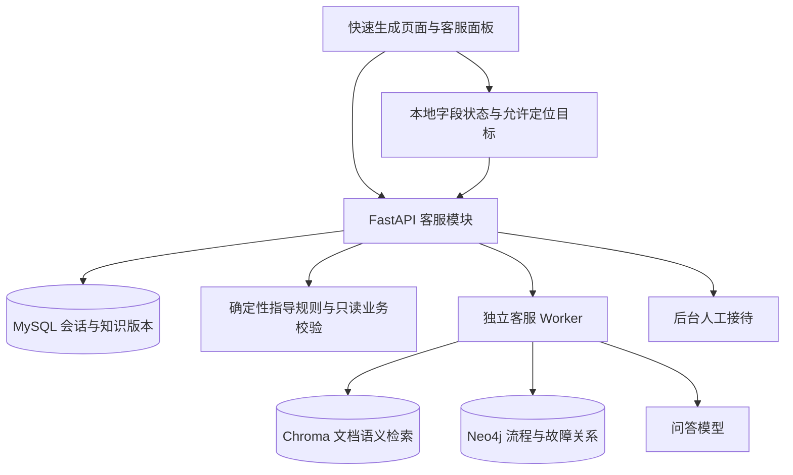

# AI 客服开发计划：Chroma＋小范围 Neo4j＋页面操作指导

日期：2026-11-03。状态：**待用户审核；未开始实施**。

本轮交付开发计划与简单自评，不安装依赖、不迁移数据库、不调用模型、不修改业务代码、不部署。审核通过代表接受计划，不代表功能已完成或生产已启用。

## 1. 审核摘要

目标：让玲玲能回答平台使用问题，并结合用户当前快速生成页面，解释还缺什么、下一步应做什么，提供字段或按钮定位；答不了时转人工。

| 决策 | 状态与本计划处理 |
| --- | --- |
| Chroma＋小范围 Neo4j | 用户已确认；不再沿用旧计划的 MySQL 关键词检索方案 |
| 结合当前页面指导操作 | 用户已确认；首批覆盖快速生成，优先商品资料步骤 |
| 知识素材由 Codex 整理，再审核导入 | 用户已明确准备方向；支持前文约定的 Markdown＋JSONL 素材包 |
| 首版仅登录用户使用真实客服 | 沿用 2026-10-19 已确认范围；公开宣传页继续可访问 |
| 右下角入口、文字客服、后台人工接待、客服不扣创作积分 | 本计划建议，供本次审核；具体新增界面仍需设计稿确认 |
| 问答与向量模型、预算、服务器容量、客服人员与保留期 | 尚未确定；不阻碍使用隔离环境和模拟服务开发，真实启用前落实 |

首版不包含语音、实时数字人、跨会话个人记忆、电商外部渠道接入、自动填写商品资料、自动提交/退款/发积分。只读查询限当前用户当前快速生成任务所需状态，不开放通用数据库查询或自由工具调用。

## 2. 依据、现状与旧计划关系

已核对的代码事实：

| 来源 | 观察结果与影响 |
| --- | --- |
| `frontend/src/router.ts` | 快速生成路由为 `/workspace/quick/:runId?`；客服宣传页为 `/ai-customer-service` |
| `frontend/src/features/site/customer-service/CustomerServiceView.vue` | 当前是本地固定问答演示，不作为已有真实客服基础 |
| `frontend/src/features/quick-generation/QuickGenerationView.vue` | 实际步骤为商品确认、营销文案、图片生成、视频生成，完成后汇总；商品步骤按钮为“确认商品，生成文案” |
| `frontend/src/features/quick-generation/QuickProductEditor.vue` | 存在未保存本地字段、保存状态及动态必填项；当前只 expose save/dirty/busy，需新增只读指导摘要 |
| `frontend/src/features/quick-generation/useQuickGeneration.ts` | `step` 与 `progressStep` 分离；必填项取 Agent 能力；上传、冲突、提交结果不明、任务锁定都会影响下一步 |
| `backend/app/quick_generation/{routes,service,schemas}.py` | 已有按用户访问的业务接口与版本化状态，后续复用权限和状态读取，不另造客服业务状态 |
| `frontend/package.json`、`backend/pyproject.toml` | Vue 3 / TypeScript / Element Plus、FastAPI / SQLAlchemy / MySQL / Redis 可复用 |

设计依据：`AGENTS.md`、`docs/product-design.md`、首版需求终稿、`docs/ui-remediation-manual-2026-10-13.md`、`DESIGN.md` 和 `docs/design/feima-ui-2026-10-29/README.md`。

历史参考：[旧方案](../specs/2026-10-19-ai-customer-support-design.md)、[旧计划](2026-10-19-ai-customer-support.md)。新版独立作为执行入口，不直接照抄旧任务：

- 替换旧稿的“无向量库”、关键词问答与禁止一切当前任务读取，采用受控检索及最小只读上下文。
- 继承会话隔离、人工接管、消息幂等、独立 Worker、预算及故障恢复原则；旧稿工程数值不自动成为生产默认。
- 工作台客服和后台沿用飞马蓝色双主题；宣传页已确认的浅色童话视觉仅适用于该页，不恢复旧稿暖色。
- 不改原快速生成字段、保存与收费流程。新增客服界面设计先审后编；现有宣传稿的确认不等于新增客服面板确认。

## 3. 架构与职责

| 组件 | 职责 |
| --- | --- |
| MySQL | 会话、消息、作业、人工状态、知识原文与不可变版本、导入记录、发布指针、预算与审计的事实源 |
| Chroma | 已审核文章的语义检索索引；可由原文重建，不存个人会话和实时表单数据 |
| Neo4j | 快速生成 Page / Step / Field / Action / Condition / Issue / Resolution 及有限关系；不复制订单、用户、积分或任务实例 |
| Redis | 限流、在线心跳及可丢弃缓存；不作为会话和作业唯一存储 |
| SSE | 持久化消息和状态的变更通知；首版建议完整回复展示，不做逐 token 推送 |
| 模型适配器 | 问答模型与 embedding 模型独立配置；服务端保管密钥、超时、输入限制和费用记录 |

开发可用隔离 Chroma 持久化实例，部署建议采用私网独立服务；Neo4j 首版单实例、固定查询模板。实施时验证并锁定服务/驱动版本及许可、容量、备份要求，不把单节点写成高可用。两库不暴露公网，导入写权限与在线只读权限分离。

## 4. 知识库准备、导入与发布

### 4.1 素材契约

兼容用户准备的 `docs/knowledge-base/`：

- `articles/*.md`：稳定 id、title、status、implementation_status、applicable_routes、source_refs，以及问法、回答、步骤、异常和人工边界。
- `planned/`：设计中或未实现内容，默认排除。
- `graph/nodes.jsonl`、`graph/edges.jsonl`：稳定节点 ID、类型、关系端点、来源；有条件的边需条件标识。导入时边可由 source/relation/target/condition 生成确定性 ID。
- `page-context-contract.md`、`evaluation.jsonl`、`review-checklist.md`：分别用于实施映射、评测、人工审核，不作为普通回答正文自动导入。

运行时补充 article_revision、content_hash、graph_revision、release_id、schema_version 与产品适用版本。仓库路径/行号只用于内部取证，用户答案显示文章标题与受控帮助链接，不暴露内部路径。发布前核对实际部署能力，不能以 `implemented` 推断生产已上线。

### 4.2 导入流水线

1. **预检**：校验格式、稳定 ID、来源、边端点、重复项、类型白名单、大小与秘密信息；生成新增/修改/撤回差异报告，不默认发布。
2. **入草稿**：原文和图谱规范数据存入 MySQL 不可变修订；相同文件哈希重导入不创建重复版本。人工审核文章及关键关系。
3. **构建发布候选**：按标题和步骤语义切分，初始约 300–600 中文字、少量重叠，评测后调整；chunk ID 包含文章版本、切分器版本与内容哈希。
4. **构建两库**：Chroma 保存向量、正文和检索元数据；Neo4j 保存同一 release 下的通用节点与关系。只用结构化参数及固定 Cypher，不执行导入文件或模型提供的查询。
5. **校验并激活**：两库计数/哈希/引用与抽样查询通过后，在 MySQL 事务内切换单一 active_release 指针；任何一侧失败都保持旧版本，失败任务可幂等续跑。
6. **撤回与回滚**：撤回在 MySQL 立即生效，检索和答案发布均复核；新版本异步清理两库。回滚只能选完整可用且未被撤回限制的 release，不能复活已撤回规则。

各次检索固定一个 release，查询两库都强制过滤，不混用不同版本。历史答案保留引用快照；已撤回来源显示失效标识，不悄悄重写旧消息。缓存包含 release、模型/切分版本与失效标识，撤回后不能命中旧答案。

Neo4j 节点与边的存储身份同时包含 release_id 和稳定逻辑 ID，不能用单一逻辑 ID 的 MERGE 覆盖旧 release；关系两端必须属于同一 release。激活使用 expected_version 防止并发覆盖；旧索引至少保留到在途读取结束，清理失败可重试。在线查询的 release 过滤由服务端强制加入，不能只依赖模型或前端参数。

embedding 模型、维度、归一化和距离度量在发布清单中固定；更换 embedding 模型必须构建新 collection 并重嵌入，问句与文档使用同一配置。导入和在线问句 embedding 都计入独立可追踪预算。

首版提供管理端导入包、预检结果、审核、发布/撤回和历史版本；底层同时提供可重复运行的管理命令。上传仅接收明确文本格式，限制大小/数量和路径，不自动抓网站、不运行上传内容。

## 5. 检索与回答策略

1. 权限检查、限流、持久化问题与最小上下文；任务状态通过原业务权限读取，浏览器传入值不构成权限证明。
2. “下一步/缺什么”优先走确定性指导规则；有可靠页面条件时，即使无文档命中或模型不可用也可返回准确的模板指引。
3. 使用说明走 Chroma；步骤依赖、故障关系按固定模板查 Neo4j，首版限制关系类型、跳数和结果量，不让模型生成自由 Cypher。
4. 路由/步骤过滤用于优先排序；用户明确询问其他功能时允许搜索相关已发布资料，避免被当前页面锁死。候选召回与阈值通过中文真实问法评测，不把距离值当模型置信度。
5. 模型仅接收本轮获准知识、有限会话历史和脱敏状态。来源内容及用户文本均当数据处理，不执行其中指令。
6. 输出结构：`answer`、`disposition=answered|clarify|handoff`、`citations`、`guidance_targets`、`context_revision`、`release_id`；服务端校验来源确实被检索、目标属于白名单，错误输出降级。
7. 同时复核知识撤回、账户状态、会话接管版本及任务版本；若状态过期，不能把旧状态结论作为当前建议发送。引用有效不代表语义必然正确，仍需评测。

无依据则追问/转人工；故障图谱只提供“可能原因及核查方法”，不能将通用关系推断成用户本次失败原因。费用和结算结论只来自已授权实时接口，不据图谱判断退款或重复生成。

## 6. 当前页面指导契约

每次用户提问捕获快照，不逐键发送数据或自动调用模型。前端维护递增 `context_revision`，换页面、run、步骤或关键字段/状态变化时使旧定位建议失效。

前端状态是有长度和枚举约束的不可信提示；字段标签/操作标签由版本化契约映射，用户文本不能冒充系统指令。后端无法核实尚未保存的字段值时，只承认其为客户端声明，不据此放宽任何业务校验。模型回复到达时，前端再次比较 revision；过期的当前操作结论标为旧快照说明并禁用定位，不能继续突出显示为实时建议。

| 字段 | 来源与用途 |
| --- | --- |
| schema_version / page_id / route_name | 固定枚举；原始 URL/query 不直接上传 |
| run_id / run_version | 当前任务标识；后端校验归属并读取权威状态 |
| view_step / progress_step | 区分当前查看与实际推进到的步骤 |
| fields | field_id、label、required、filled、valid、error_code、dirty；含本地未保存状态，不含完整字段值 |
| page_state | 上传/保存中、只读、冲突、提交结果不明、任务锁定、费用确认层打开等 |
| available_targets | 前端登记的字段/按钮标识、当前文字、可定位性；不能由模型自造选择器 |
| rule_version / context_revision | 指导规则版本与页面状态版本，控制旧回复及旧操作卡失效 |

新增统一的纯校验/指导摘要适配器，复用现有真实校验；任何为共享逻辑所做重构必须保留原行为。不能额外写一套必填项，也不能把“主图必填”或“卖点必填”硬编码为全部文案场景规则。

指导优先级：身份/加载错误 → 只读/冲突/提交不明 → 正在上传保存/任务阻塞 → 缺失或无效字段 → 当前允许的下一动作。未保存字段只能以“当前页面填写情况”描述，不能称其已经保存到服务端。

**第一步实际示例**：缺少商品类型时定位该字段；条件满足时解释“点击『确认商品，生成文案』，系统会先保存资料并打开文案需求设置”，不把它描述成直接完成生成。用户仍在原流程确认内容和费用。

定位动作仅允许滚动、高亮、聚焦；不执行按钮点击、不调用 `save` / `advance` / `prepare` / `submit`。原 `goToStep` 可能保存草稿，因此首版客服不通过它自动切步骤。需要切步骤时指向既有步骤按钮，由用户操作。

本地每次执行定位前重新检查账户、run、revision、目标存在且可见；过期提示“页面已变化，请重新获取指引”，不自动重发付费问答。对历史消息同样停用旧定位卡。客服层与费用确认/编辑层不争夺焦点，定位前按确认设计收起客服并保留草稿。

## 7. 会话、人工与可靠性

- 独立 `support` 领域，不复用创作任务、作品或积分计费。建议客服免费使用，后台限制平台 AI 预算。
- MySQL 保存会话、消息、AI 作业、事件、幂等回执、预算、知识修订、导入任务和 release 清单。外部调用不持有数据库事务。
- 会话状态：`AI_ACTIVE → WAITING_HUMAN → HUMAN_ACTIVE → RESOLVED`；人工释放回等待。转人工、结束和接管更新 routing_epoch，迟到 AI 回复不能发布。
- 消息写入/作业/事件同事务；重复发送意图使用同一幂等键。同一会话首版只允许一个在途 AI 问题，但可随时转人工。
- 独立 Worker 通过租约和唯一约束领取、发布；外部模型超时或结果未知不自动重复计费调用，明确提示失败并支持人工或用户显式重试。
- SSE 断线只补读持久化结果；不重发问题。前台可见时有限退避读取，隐藏或终态不持续无意义轮询。
- 所有读写与 SSE 复核用户/客服权限；退出与换号清空客户端上下文，迟到响应按身份版本丢弃。人工权限只覆盖客服内容，不顺带获得用户素材访问权限。
- 在线信息未知或无人值守时允许留言，不承诺接通、排队名次或响应时长。
- 模型/Chroma 故障时保留人工与确定性页面指导；Neo4j 故障可保留有独立文档依据的普通问答，不伪造关系结论。索引故障不切到模型自由回答。
- 会话保留期覆盖消息、上下文快照、备份与审计；明确哪些只保留摘要。生产启用前实现已确认的清理策略，日志不记录明文 Key、完整表单或敏感正文。

## 8. 开发阶段与交付

以下路径除第 2 节已有文件外均为拟新增位置，迁移编号按实施时实际 head 确定。所有任务待执行；顺序实施，无默认多代理要求。

| 阶段 | 任务与主要位置 | 验收及依赖 |
| --- | --- | --- |
| P0 方案与交互 | 确认本计划；`docs/design/context-aware-support/` 补客服面板、后台接待、导入发布、字段定位的桌面/手机稿 | 新稿确认后编对应 UI；不重做现有业务页面 |
| P1 知识素材与基础设施 | 验证 `docs/knowledge-base/`；新增 `backend/app/support/knowledge/` schema、隔离 Chroma/Neo4j 可选部署配置 | 模型/驱动兼容性验证；未启用客服时原服务照常启动 |
| P2 人工客服闭环 | `backend/app/support/{models,schemas,routes,permissions,conversations,events}.py`、迁移；`frontend/src/features/{support,admin/support}/` | 两用户、两客服权限隔离；接待竞争、离线留言、恢复、结束可用；依赖 P0 |
| P3 知识导入发布 | `knowledge/{importer,chunking,embeddings,chroma_store,neo4j_store,releases}.py`；`backend/scripts/import_support_knowledge.py`；后台知识管理 | 草稿不可搜，重复导入幂等，两库失败不切版，撤回/回滚/重建可验证；依赖 P1 |
| P4 检索与问答 | `backend/app/support/{retrieval,answering,provider,budget}.py`、`backend/worker/support.py` | 问答/关系查询/追问路由、引用、预算和接管迟到控制；依赖 P2/P3 |
| P5 页面指导 | `frontend/src/features/support/{pageContext,guidanceTargets}.ts`、快速生成 context adapter、`backend/app/support/guidance.py` | 先商品步骤，再文案/图片/视频/汇总；字段摘要、状态版本、定位白名单；依赖 P2，AI 解释接 P4 |
| P6 联调与交付 | 客服定向单测、隔离数据库集成测试、真实模型评测；`docs/verification/`、`infra/runbooks/customer-support.md` | 双端和双主题、故障、成本、恢复及部署核对；依赖全部阶段 |

建议里程碑：M1=P2 人工闭环；M2=P3/P4 可溯源知识问答；M3=P5 页面指导；M4=P6 达到启用条件。M1/M2 是中间交付，完整范围包括 M3/M4。

接口组在实施时细化并导出 OpenAPI：

- 用户：`/support/bootstrap`、`/support/conversations`、会话消息/转人工/结束/阅读/显式重试、`/support/events`。
- 指导：消息请求携带可选 `page_context`，返回已验证定位目标与上下文版本；确定性指导可提供无模型调用的读取接口。
- 后台：`/admin/support/conversations` 接待/回复/释放，`/admin/support/knowledge/imports` 预检/构建进度，`/admin/support/knowledge/releases` 激活/回滚、文章审核/撤回、模型与预算设置。
- 写入带幂等键；状态修改带 expected_version。配置只回脱敏信息，保存配置不隐式触发模型探测。

## 9. 验证与启用标准

| 验证组 | 必须覆盖 |
| --- | --- |
| 知识 | 重复/缺失 ID、坏边、计划内容排除、embedding 维度错配、构建中断、单库失败、发布并发、撤回与在途问答、缓存失效、回滚及重建 |
| 页面 | 动态必填、未保存输入、上传中、Agent 禁用、费用层、历史步骤、只读、状态冲突、提交不明、跨 run/标签页/账号、迟到回答、目标不存在或已隐藏 |
| 账户与人工 | 越权 ID、普通管理员未授权、抢接、接管时 AI 返回、权限撤销、断线恢复、重复消息、作业租约过期、预算不足 |
| 原流程回归 | 商品保存、文案需求设置、费用确认、生成与结算、图片/视频确认、已有编辑内容不被刷新覆盖；客服不能触发额外收费请求 |
| 浏览器 | 默认按 ego-browser 技能执行；1440px 桌面与 390px 手机、双主题、键盘焦点、滚动定位、减少动态效果、弹层遮挡 |

素材准备的约 30 问是初始集；上线前建议扩为至少 80 问：知识问答 30、页面状态指导 25、流程/故障关系 10、无依据或需追问 10、越权/提示注入 5。真实模型人工评分，建议有依据回答正确率 ≥90%；25 条页面场景不得推荐当前禁止动作，15 条无依据/安全样本不得编造业务承诺或执行越权动作。有限样本达标不代表永远不会答错。

记录命中率、来源有效性、回答正确率、首响应/完整响应 p50/p95、token/embedding 用量、估算成本及人工转接率；耗时与预算目标在选定模型和测试机器后锁定，不能编造现成 SLA。

实施时执行受影响的 pytest/Vitest、类型检查、构建、OpenAPI 与 TypeScript 契约检查；新增数据库行为用隔离 MySQL/Chroma/Neo4j 真实集成测试，不只用 mock。真实模型效果单独记录，模拟接口通过不替代语义评测。

部署前交付：容量测量、模型供应商数据说明、人员授权、预算、保留/清理策略、三库一致快照或索引重建演练、开关降级与版本回滚手册。关闭 AI 不删除会话；索引可重建，备份仍以 MySQL 原文/修订/release 清单为依据。

## 10. 工作量与用户审核项

单名熟悉项目的全栈开发者粗估 **18–28 人日**：方案/设计 2–3、基础与人工闭环 4–6、知识导入/两库检索/模型 5–8、页面指导 3–5、集中验收 4–6。阶段合计范围为 18–28，不含素材修订、评审等待、供应商开通；不是工期承诺。知识稿规模和模型评测结果变化时重新估算。

本次请审核：

1. **首版范围**：登录用户、站内文字客服、后台人工接待，快速生成全流程指导，商品资料步骤优先。
2. **交互边界**：客服解释并定位，业务按钮仍由用户点击；推荐工作台右下角面板，具体稿件另审。
3. **知识管理**：素材包导入 → 草稿审核 → 两库构建 → 显式发布，后台提供版本与撤回；不自动把仓库全部内容上线。
4. **计费建议**：客服不扣创作积分，平台承担模型与 embedding 成本并设置预算。

后续真实启用时再填写：问答/embedding 模型与预算、服务器部署规格、授权客服和值守安排、会话及备份保留期。未确定前不预设免费额度或 24 小时在线等政策。

简单自评见[评审记录](../../verification/context-aware-ai-support-plan-review-2026-11-03.md)。
