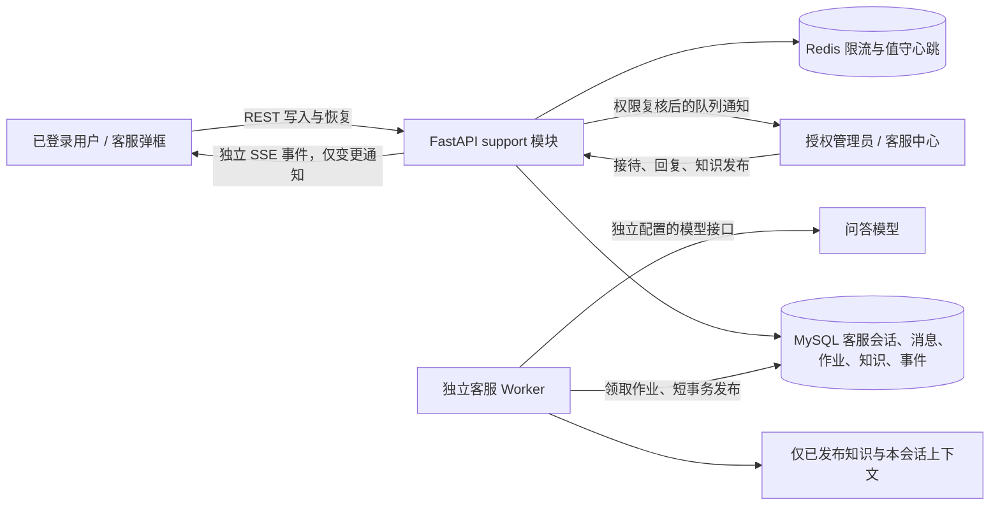

# AI 客服可行性评估与方案草案

日期：2026-10-19。状态：技术评估与待评审方案；本轮只交分析和开发计划，没有实现、迁移、调用真实模型或启用服务。

## 1. 目标、已确认项与范围

用户希望在页面右下角或左下角增加客服悬浮入口，点击打开弹框，回答系统使用问题；AI 无法回答时可以转人工，并在管理后台查看和接待对话。用户进一步确认：**首版只支持已登录用户**，暂不支持访客。

本方案建议首版提供：系统知识问答、持久化多轮客服对话、用户主动转人工、人工待接待列表与回复、离线留言、未读提醒、知识发布及独立客服配置。客服对话独立于商品创作会话、生成任务、作品与积分账本。

推荐项仍待用户审阅：右下角入口；站内人工接待；客服不扣用户创作积分；纯文字对话；管理员兼任客服，通过额外授权限定人员；完整回复展示而非逐字流式输出。这些不是已确认的生产政策。

首版不含：访客身份、图片/文件/语音消息、微信或企业微信转接、邮件/短信通知、智能分单、满意度、独立客服角色、跨语言翻译、自动退款/赠送积分/重置密码/重跑任务、全站文档爬取和向量数据库。

依据：用户本轮指令、`AGENTS.md`、`docs/product-design.md`、需求终稿、界面整改手册、V2 暖色视觉基准及公共控件约定。客服是用户明确提出的新增范围，不借此重做原有非首页流程；新增界面先补原型与高保真稿，确认后编码。

## 2. 可行性结论与现有证据

**技术可行，适合在现有单体平台中增加独立 `support` 模块，无须先拆出新微服务或引入 WebSocket。** 有模型接口、已发布知识和实际人工值守后才能验收完整效果。下表来自当前文件读取，不代表对运行中服务进行了验证。

| 能力 | 当前代码证据 | 可复用与缺口 |
| --- | --- | --- |
| 前端 | `frontend/package.json`、`src/App.vue`、`src/components/AppShell.vue` | 已有 Vue 3、TypeScript、Element Plus 和全局外壳，可挂载一个跨路由客服入口 |
| 弹层与主题 | `src/components/AppDialog.vue`、`AppOverlay.vue`、`src/styles/tokens.css` | 复用焦点、关闭和主题；现有弹框只有居中样式，右下角定位需向后兼容扩展 |
| 登录与身份切换 | `frontend/src/features/auth/session.ts`、`backend/app/auth/models.py` | 同源 cookie、CSRF、身份 epoch、账户状态可复用；所有客服资源新增归属校验 |
| 后端与持久化 | `backend/pyproject.toml`、`app/db.py` | Python 3.12、FastAPI、SQLAlchemy、MySQL、Alembic、Redis 已具备；新建客服数据表 |
| 模型调用 | `app/assist/provider.py`、`app/assist/configuration.py` | 已有 OpenAI 兼容 HTTP、只写密钥、超时/响应大小限制的模式；辅助服务提示词专用于创作，不能直接作为客服服务 |
| 文本 Agent | `app/agents/text.py`、README 的文本服务协议说明 | 面向商品文案生成，不能假定支持知识问答、多轮对话或客服流式协议；首版不通过收费创作任务调用它 |
| 事件传输 | `app/events/routes.py`、`service.py`、`models.py` | 可参考 SSE 鉴权、短事务、断线恢复；现有事件强绑定 generation_tasks 与 task.updated，需独立客服事件通道 |
| 后台 | `frontend/src/router.ts`、`AppShell.vue`、`backend/app/admin/permissions.py` | 可增加客服模块；现有角色只有 user/admin，首版无需新增角色 |
| 用户内容访问 | `app/admin/content_access.py`、`app/config.py` | 普通后台权限不授予私有内容读取；现有内容审批仅 TEST_ONLY，不能当客服生产权限直接复用 |
| 异步执行 | `backend/worker/main.py`、`app/dispatch/*` | 当前调度绑定生成任务；新建轻量客服 Worker，避免占用图片/视频执行槽 |

项目已有较多未提交变更，历史 README 的接入状态和迁移 head 部分落后于当前代码。本方案以实际相关代码为依据；实施前重新检查工作区、Alembic head 和接口，不覆盖其他工作。

## 3. 方案比较

| 方案 | 优点 | 代价与适用情况 |
| --- | --- | --- |
| **推荐：站内模块＋独立问答模型＋受控知识库** | 会话与登录账户一致；后台查看、权限、转人工均可控；沿用现有技术栈 | 需要自行开发接待和恢复机制，适合本项目首版 |
| 第三方完整客服平台 | 往往已有排队、多坐席、报表和外部渠道 | 需采购并确认 API/SDK；增加外部数据存储、账户映射、单点登录和同步依赖；接入速度取决于平台 |
| 先接 AI 知识平台，再自建人工后台 | 后续大量文档和知识检索工具较丰富 | 首版仍需自建会话与转人工，还增加部署及两边状态协调；知识量扩大后再评估 |

首版知识量按几十至数百条 FAQ/操作说明规划。用 MySQL 存储、关键词检索和发布快照即可起步；中文召回评测不达标时，再决定是否使用 MySQL ngram 全文索引或向量检索，不预先安装额外服务。

## 4. 用户与后台流程

### 4.1 用户端

1. 登录后在用户页面显示一个悬浮入口；后台页面不显示用户客服弹框。已登录访问首页也可显示；登录、注册页面及未登录首页不显示。
2. 点击打开客服弹框，显示 AI 标识、消息列表、输入框、“转人工”及显式关闭；跨路由保留会话，刷新从服务端恢复。关闭弹框不等于结束会话。
3. 首次发送时创建或找回唯一未结束客服会话。打开入口但不发送，不制造空会话。展示可配置常见问题和“回答由 AI 提供，以系统实际显示为准”。
4. AI 基于已发布知识和本会话有限上下文回答；无相关知识、涉及账户具体异常或模型失败时，说明限制并展示转人工入口。用户随时可主动转人工，不依赖模型判断。
5. 用户点击“转人工”后进入待接待。保留 AI 与用户原对话；允许继续留言；不会自动恢复 AI。人工接入后明确显示人工标识。
6. 无客服值守时显示“当前暂无人工在线，可先留言”；不显示虚假接通、排队名次或预计等待时间。首版不收集额外联系方式，用户回到站内查看回复。
7. 用户或接待客服可结束会话。已结束会话只读，继续咨询创建新会话；可查看本人历史客服会话。未读只按实际读取的消息序号推进。

桌面建议右下角，避开工作台底部主操作；手机用接近全屏的同一弹框，适配安全区、键盘及 44px 触控范围。沿用暖色 token、公共按钮、输入和弹层；禁止 Esc/点击遮罩关闭，关闭恢复入口焦点。正常消息按纯文本渲染，来源只使用系统生成的内部知识链接。

右下角弹框属于本次建议，需要用户确认具体原型及高保真。公共弹层默认仍居中；只增加可选定位和业务 footer 插槽，不改既有弹窗与抽屉行为。收费/删除弹框优先级更高，客服关闭或暂时收起且保留草稿，不叠加焦点陷阱。

### 4.2 管理后台

新增“客服中心” `/admin/support`，包含“会话接待”“知识库”“客服设置”三个范围内的入口。

- 会话接待：全部、待接待、接待中、已结束；按用户可见编号、状态、接待人和时间筛选，游标分页。默认不在列表展示消息正文。
- 点击会话进入客服对话视图：完整客服时间线、AI/人工/系统标识、接待人、来源知识版本；接待、回复、释放回待接待、结束。纯 AI 会话也可查看，不能在 AI_ACTIVE 下直接人工插话，须先原子接待。
- 多人同时接待只允许一人成功；只有当前接待人可以回复。其他授权客服可只读查看；首版不做强制抢接/自动转派。原接待人被停用或移出客服授权时，其他授权客服可填写原因，将失效接待恢复到待接待，再正常接待；需重新校验权限事实、版本及审计，普通离线或网络异常不作为抢接依据。
- 知识库：标题、分类、关键词/同义问法、正文、来源说明；草稿编辑抽屉、显式发布/撤回。只有发布版参与回答。
- 客服设置：服务开关、独立模型地址/名称/只写 Key、服务提示与常见问题；连接测试仅在管理员明确点击时执行，并提示会调用模型。上线所需模型预算及限额必须显式配置。
- 值守：客服主动设为值守后，每 15 秒心跳，45 秒过期；退出或离开接待页失去心跳后显示离线。在线只表示近期有值守心跳，不承诺即时响应。
- 未读和待接待数量为站内提醒，不发送外部消息；后台关闭后没有系统推送承诺。队列保存在 MySQL，不随心跳丢失。

## 5. 结构与数据归属

MySQL 是事实源。Redis 只做限流与在线提示；SSE 只发消息/状态变化通知，客户端再读取持久化内容，断线不改变作业和会话。首版不做 token 流式，展示真实“正在回答”状态和最终完整结果，禁止模拟打字片段。

| 新增表 | 关键内容与约束 |
| --- | --- |
| support_conversations | id、owner、state、state_version、routing_epoch、next_message_seq、assignee、双方 read_seq、时间；以可空生成列＋唯一索引保证每用户最多一个未结束会话 |
| support_messages | conversation_id、seq、role(user/ai/human/system)、sender、content、client_message_id、payload_hash、reply_to、job_id、citation_snapshot；(conversation_id,seq)、发送方范围幂等键、AI job_id 唯一；可空生成列保证每个用户问题最多一条成功 AI 回复 |
| support_ai_jobs | trigger_message_id、attempt_number、status、lease_token/expiry、routing_epoch、输入与知识/配置快照、错误码/用量；(trigger_message_id,attempt_number) 唯一，首次为 1，显式重试递增；可空生成列保证同一会话最多一个未完成 AI 作业 |
| support_articles | 稳定 ID、draft、current_published_revision、revision、分类和检索字段；版本号保护编辑；发布头控制可用性 |
| support_article_revisions | 不可变发布版本、正文与来源；历史回复保留原引用快照，撤回不改写历史 |
| support_settings | 单例版本号、enabled、模型配置和加密 Key、展示文案、限额；客户端只见脱敏状态；作业不保存明文 Key |
| support_events | audience_key、seq、event_key、类型、会话 ID/版本、时间；事件键与受众序号唯一，只保存必要通知元数据 |
| support_event_heads | 受众序号高水位；用户与后台受众隔离，写入与消息/状态同事务 |
| support_operation_receipts | actor、operation、request_key、payload_hash、原响应和时间；前三者唯一，状态/配置/重试操作同事务保存幂等结果；不保存 Key 等秘密 |
| support_budget_days | UTC 日期、token_limit、reserved_tokens、used_tokens；日期唯一，原子控制全站当天预算，展示时明确 UTC 日界 |
| support_budget_reservations | 唯一调用 ID（作业或连接测试）、预算日期、预留数、实用数/未知标记及结算状态；结算幂等，不改变用户积分 |

外键/查询始终校验账户和会话所属；不能只相信前端 ID。时间响应使用带时区格式；列表沿用 cursor/limit。新迁移编号实施时根据实际 head 确定，不硬编码为下一条 0036。

### 5.1 会话状态与竞争处理

| 当前状态 | 允许操作及目标状态 |
| --- | --- |
| AI_ACTIVE | 用户发消息，排一个 AI 作业；用户转人工→WAITING_HUMAN；客服直接接待→HUMAN_ACTIVE；用户结束→RESOLVED |
| WAITING_HUMAN | 用户留言但不触发 AI；客服接待→HUMAN_ACTIVE；用户结束→RESOLVED |
| HUMAN_ACTIVE | 用户和当前接待人发消息；接待人释放或授权客服核验原接待权限失效后恢复→WAITING_HUMAN；用户或接待人结束→RESOLVED |
| RESOLVED | 只读；继续咨询创建新会话，不原地重开 |

每次接管、转人工、释放、结束都更新 state_version 与 routing_epoch。AI 调用前后均检查：仍为 AI_ACTIVE、routing_epoch 未变、作业 lease_token 有效且未过期、账户仍可用。否则结果标为 OBSOLETE，不插入用户时间线。所有发布必须有数据库条件更新和唯一约束，不能只检查 Redis 锁。

首版 AI_ACTIVE 有未完成作业时禁用重复发送；另一标签页的新消息返回 409 并保留输入。用户仍可转人工。人工阶段可连续留言；状态变更带 expected_version，冲突返回 409，保留未发草稿并自动刷新状态。

消息写入、作业创建、事件写入原子提交。外部模型调用不持有数据库事务或行锁。Worker 先短事务领取，再调用，再短事务发布。进程崩溃或超时后，恢复扫描将过期 RUNNING 作业标为失败并提示可转人工；不自动重复模型调用以免重复费用。用户显式重试只为原问题创建新作业，沿用原问题且不重复消息，有独立幂等键；不适用于已转人工或已结束会话。

## 6. AI 回答与知识维护

1. 首批整理 30–50 条经人工审阅的系统 FAQ：注册登录、三类创作、快速生成、积分冻结/消费/释放、任务失败处理、作品查看下载、充值说明。以当前生效规则和实际页面为准，不能整份导入含历史规则、测试积分和内部运维信息的仓库文档。
2. 确定性标准问法可直接返回已发布答案；其余先检索已发布标题、关键词与正文，最多取 6 条，每条最多 1500 中文字符，最多 9000 字知识，并限最近 12 条消息及 6000 字会话上下文。模型输入还要按供应商上下文窗口做 token 预算，超限优先裁剪旧历史。
3. 模型输出固定结构：`answer`、`disposition=answered|clarify|handoff`、`citation_ids`。服务端校验结构和长度，引用只能来自本轮实际检索版本；越界引用、空答案、超长或解析失败均降级，不直接显示原始模型输出。
4. 无相关已发布知识时不调用模型编造；涉及具体用户扣费、任务异常或人工处理请求，引导转人工。含糊问题允许追问，始终保留用户主动转人工。
5. 模型自报置信度不作为唯一判据；命中分数、有效来源、问题类型、响应校验共同决定可展示与否。有效引用也不能证明答案完全正确，必须用真实问法评测回答事实和遗漏。
6. 首版不赋予任何业务工具调用权，不主动读取积分余额、生成任务、商品素材、作品或其他人的对话；只回答系统规则和用户在客服框主动提供的内容。相关任务编号可作为普通文本由人工再走原后台权限核查。
7. 问答连接独立配置，参考辅助模型的 httpx 和加密方式，不复用辅助模型业务服务或改动 textAgent。Key 由 `APP_SUPPORT_ENCRYPTION_KEY` 加密，缺失时 AI 不启用；模型修改后旧作业版本不匹配则安全失败，不转用新模型重试。
8. 首版模型调用总超时 30 秒、响应上限 128 KiB、答案上限 4000 字、默认建议输出上限 1500 tokens；供应商不支持对应参数时由适配器明确报错或通过已验证映射处理，不能静默假装限制生效。

建议用户消息最多 2000 字、单用户每分钟 6 次 AI 请求、每个会话一条在途 AI、Worker 全局并发 4。全局并发由数据库领取阶段串行检查保障，多进程不能各自再放出 4 个调用。数值是待评审的首版工程初值，后台配置带服务端范围校验；全站每日 token 上限必须按预算显式填写，未配置则 AI 关闭。预算按 UTC 日期计数并明确日界；按输入上限＋max_output_tokens 先预留每日 token 额度，完成后按真实 usage 调整；调用结果不明时保留预留至当日结束，不因进程重启重置预算。供应商未提供 usage 时采用保守预留值，界面不得把估算标成实际费用。人工、读取历史、转接不受 AI 预算耗尽影响。

## 7. 鉴权、内容边界与服务降级

- 用户侧每个 REST 与 SSE 请求校验有效 session 和 owner。退出、停用、换账户后断开连接并清空消息/草稿/游标；迟到响应需比对 identity epoch，不能串号。
- 首版建议以 `APP_SUPPORT_ADMIN_IDS` 明确列出授权管理员 UUID；默认空列表不授权任何客服后台内容访问。每次读取/回复及每轮 SSE 投递同时验证实时 admin 身份、active 状态和名单。配置与知识管理暂使用同一客服名单，不增加普通用户角色；更细分坐席权限放后续。
- 新客服授权只覆盖客服会话。该权限是本方案拟新增的业务授权，需用户审阅；不是绕开既有用户内容审批。查看创作素材、作品、商品及创作消息仍走原独立权限，不能从客服入口旁路访问。
- 客服弹框首次使用说明：AI 会处理用户输入，授权人工客服可查阅客服对话；避免输入密码、Key 等。仅发送本会话必要上下文到已配置模型，保留期、供应商数据使用条款及实际人员名单在生产启用前确认。
- 客服内容读取、接待、回复、释放、结束、知识发布和配置变更均审计；读取原因由操作标识“客服接待/会话复查”记录，日志不复制正文/Key。没有客服读取审计成功则不给正文。
- 写操作沿用同源 Origin、CSRF 和幂等；模型地址只允许授权后台配置，校验地址并禁重定向、不接受用户提供 URL。服务端出口限制云元数据等目标，需测试 DNS 解析后的地址，不能仅做字符串过滤。聊天正文纯文本，提示注入不能获得工具权限。
- 模型不可用、预算耗尽或超时：保留用户问题，返回可解释状态并允许转人工；客服模块开关与 AI 开关分开，关闭 AI 不影响人工。
- Redis 不可用：在线状态显示未知；新 AI 受理因限流不可验证而暂拒；历史读取、转人工及人工回复以数据库限流/权限为准继续；不谎报所有客服在线。
- SSE 失败：前台可见时每 5 秒 GET 增量恢复，隐藏后暂停或退避；只重新 GET，不自动 POST；恢复后去重。轮询/重连均重新鉴权。
- 尚未确认会话保留政策前，开发不实现自动删除。生产启用前确认保留天数、备份保留和删除流程并实现清理；不能以“默认保留 90 天”替用户确定政策。

## 8. 拟定接口

所有路径以前缀 `/api/v1` 表示。响应模式、时间、cursor/limit、错误和 CSRF 继承项目。写操作带 Idempotency-Key；改变状态/草稿配置还带 expected_version。同键同载荷返回原结果，同键异载荷返回 409。

| 接口 | 行为 |
| --- | --- |
| GET /support/bootstrap | 当前账户客服可用性、公开配置、唯一活动会话、未读数、可见权限；不返回模型秘密 |
| GET /support/conversations | 本人客服会话分页 |
| POST /support/conversations | 幂等获取/建立未结束会话；用户首次发送前调用 |
| GET /support/conversations/{id} | 本人会话状态与阅读游标 |
| GET /support/conversations/{id}/messages | 按消息序号增量读取，支持历史分页；只读知识来源快照按会话权限返回 |
| POST /support/conversations/{id}/messages | 发送消息并原子创建 AI 作业或人工留言；返回 message、job 状态及服务端版本，不等模型返回 |
| POST /support/conversations/{id}/handoff | 转人工，更新 routing_epoch，取消未执行 AI |
| POST /support/conversations/{id}/resolve | 本人结束会话 |
| POST /support/conversations/{id}/read | 幂等推进不超过实际可见消息上限的阅读序号 |
| POST /support/conversations/{id}/retry | 为失败问题显式重试 AI；不复制原用户消息 |
| GET /support/events | 用户专用 SSE；只有本人会话变更元数据 |
| GET /admin/support/conversations | 授权客服会话分页与队列数量 |
| GET /admin/support/conversations/{id} | 有审计地读取客服会话元信息及时间线入口 |
| GET /admin/support/conversations/{id}/messages | 有审计地增量/分页读取客服正文 |
| POST /admin/support/conversations/{id}/claim | 从 AI 或待接待原子接待；使 AI 作业失效 |
| POST /admin/support/conversations/{id}/messages | 当前接待人回复 |
| POST /admin/support/conversations/{id}/release | 当前接待人释放回待接待，不自动切 AI |
| POST /admin/support/conversations/{id}/recover | 仅原接待人停用或失去客服授权时，其他授权客服带原因恢复为待接待；无普通抢接含义 |
| POST /admin/support/conversations/{id}/resolve | 当前接待人结束 |
| POST /admin/support/conversations/{id}/read | 按当前接待人推进人工阅读序号；其他只读查看不清接待人未读 |
| POST /admin/support/presence | 值守/离线心跳，不决定会话归属 |
| GET /admin/support/events | 授权后台受众的变更元数据，逐次校验客服权限 |
| GET/POST /admin/support/articles | 列表/创建知识草稿 |
| PATCH /admin/support/articles/{id} | 带版本更新草稿 |
| POST /admin/support/articles/{id}/publish 或 withdraw | 发布/撤回知识，保留发布历史 |
| GET/PATCH /admin/support/settings | 脱敏读取/带版本保存，AI 开关独立于人工入口 |
| POST /admin/support/settings/test | 明确触发连接测试，计入模型预算；不把保存变成自动调用 |

事件类型 `support.message.created`、`support.conversation.updated`、`support.queue.updated`、`reset`。游标绑定当前受众；越界/过期/其他用户游标只返回通用 reset，前端读取快照恢复。首版客服事件不复用原 `/events` 表和任务 DTO。

## 9. 效果、成本与可交付边界

开发估算为 **12–18 人日**，适用于一个熟悉项目的全栈开发者，包含设计、可靠性、授权与双端验证；模型协议异常、知识修订及用户评审等待可能延长日历时间，不是排期承诺。

成本包括模型输入/输出 tokens、既有数据库增量及人工值守。按月调用量 N、平均输入 I/输出 O、每百万 token 单价 Pi/Po，模型月成本约 `N × (I×Pi + O×Po) / 1,000,000`；未选模型前不编造人民币报价。FAQ 命中可避免模型调用，预算和上下文上限控制费用；接待质量仍取决于实际运营人员。

建议验收集至少 80 问：50 条有知识支持、15 条知识外、10 条含糊需追问、5 条试图获取秘密或操作权限。由人工逐条检查答案/来源/转人工；作为启用建议，知识内事实正确率至少 90%，15 条知识外不编造答案，5 条越权不泄露或执行。语义质量仍需持续抽检，不宣称 AI 能完美判断自己答不了。

## 10. 实施前与启用前决策

| 决策 | 当前状态 | 影响 |
| --- | --- | --- |
| 首版只支持已登录用户 | 已确认 | 可直接作为开发范围 |
| 右下角、弹框大小及后台会话视图 | 本方案推荐 | 原型和高保真确认后开始相应 UI 编码 |
| 站内人工接待、管理员兼任客服 | 本方案推荐 | 决定授权名单及值守流程 |
| 客服不扣创作积分 | 本方案推荐 | 确认后独立模型预算，不接账本 |
| 问答供应商、模型、Key、每日预算及限额 | 未选择 | 受控 mock 可开发；真实 AI 启用前必须配置并验证 |
| 首批 FAQ 与现行产品规则 | 需审阅发布 | 无已发布知识时不开放模型自由问答 |
| 人工值守人员、时间与服务说明 | 需运营确认 | 决定用户能获得的人工支持，不假定 24 小时在线 |
| 客服对话权限、保留期、供应商数据说明 | 需确认 | 生产启用前落实，不沿用 TEST_ONLY 内容授权 |

本轮按用户明确要求直接形成评估和计划草案，供一次性评审；未把计划生成视为实施授权。后续执行入口见 [开发计划](../plans/2026-10-19-ai-customer-support.md)。
